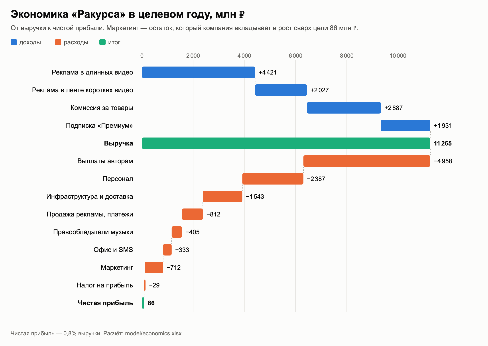
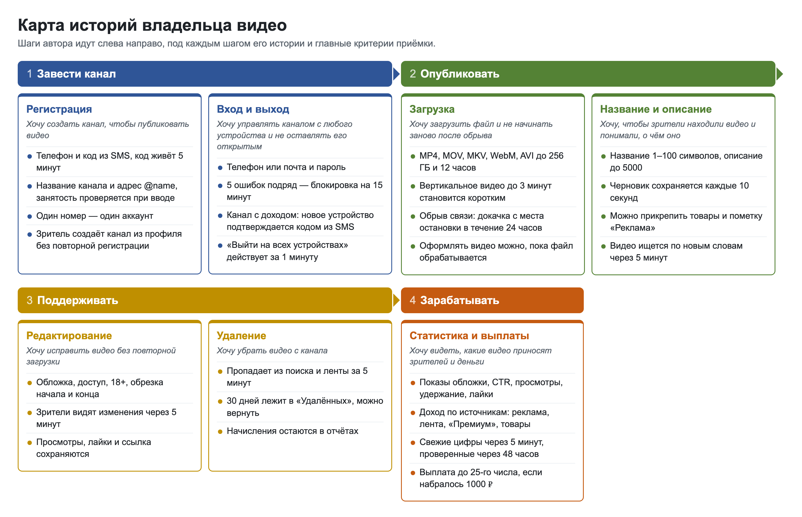
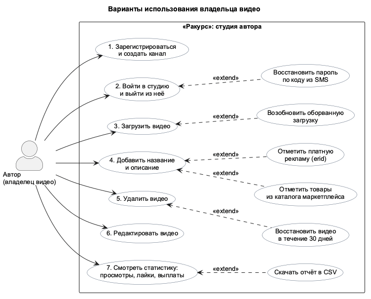
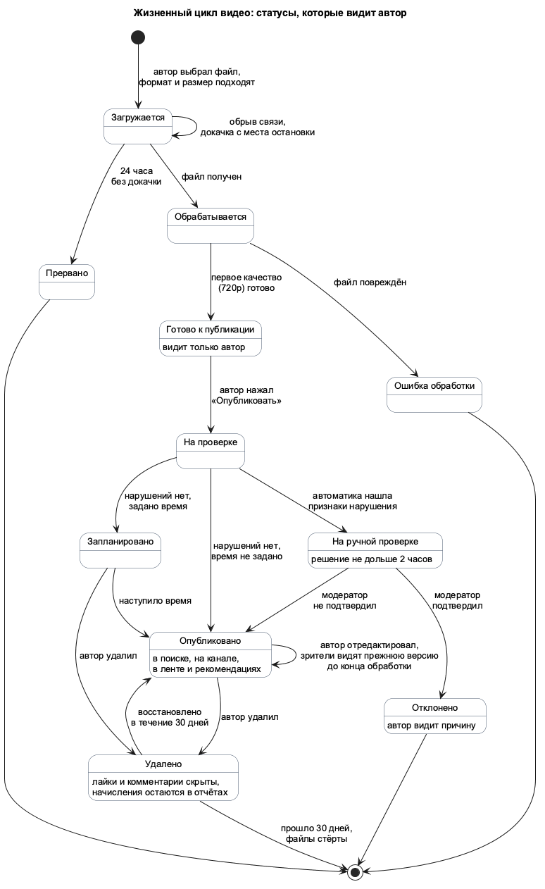
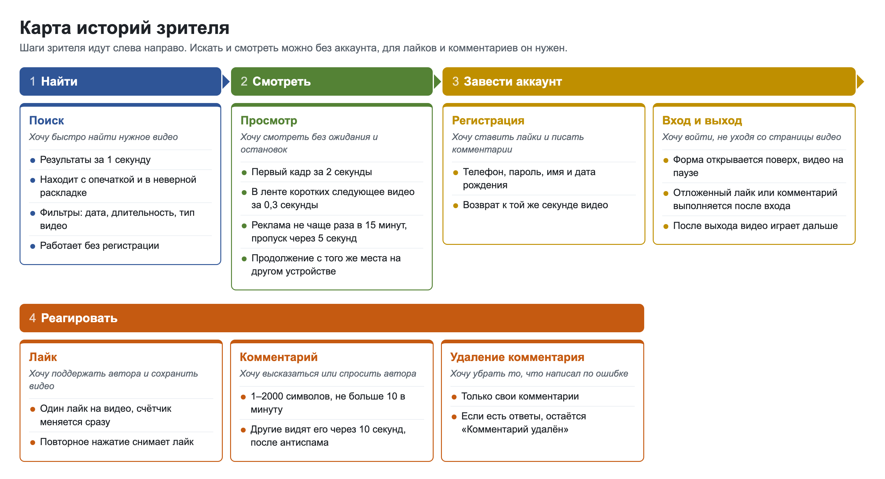
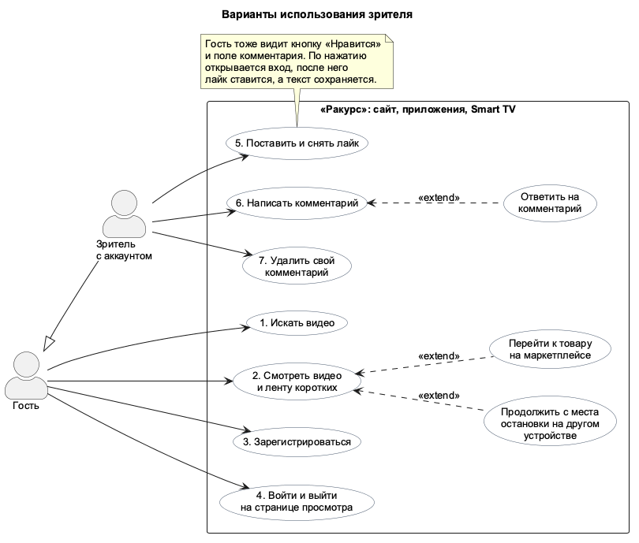
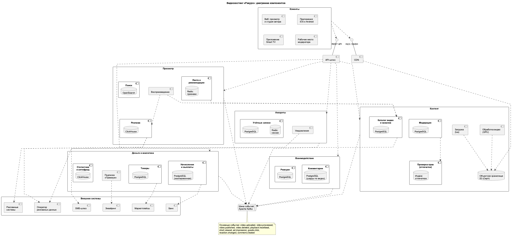

# Архитектура видеохостинга «Ракурс»

Домашнее задание, вариант 1 (учебный кейс). «Ракурс» — вымышленный сервис, но правила работы взяты у реальных площадок. Монетизация, реклама и подсчёт статистики устроены как у YouTube, лента коротких видео и продажа товаров из видео — как у TikTok. Размер рынка посчитан по данным Mediascope, цены — по открытым данным о российском рынке. Номера в квадратных скобках ведут на [список источников](#11-источники).

Все расчёты собраны в таблице [model/economics.xlsx](model/economics.xlsx). На листе «Допущения» лежат исходные числа с источниками, на листе «Расчёт» формулы. Если поменять синюю ячейку, пересчитается вся модель, включая прибыль.

1. [Продукт и правила](#1-продукт-и-правила)
2. [Расчёт масштаба и экономики](#2-расчёт-масштаба-и-экономики)
3. [Пользовательские истории владельца видео (задача 1)](#3-пользовательские-истории-владельца-видео-задача-1)
4. [Пользовательские истории зрителя (задача 2)](#4-пользовательские-истории-зрителя-задача-2)
5. [Нефункциональные требования (задача 3)](#5-нефункциональные-требования-задача-3)
6. [Бизнес-процесс загрузки видео (задача 4)](#6-бизнес-процесс-загрузки-видео-задача-4)
7. [Бизнес-слой и слой данных](#7-бизнес-слой-и-слой-данных)
8. [Диаграмма компонентов (задача 5)](#8-диаграмма-компонентов-задача-5)
9. [Диаграмма развёртывания (задача 6)](#9-диаграмма-развёртывания-задача-6)
10. [Что в расчёте не проверено](#10-что-в-расчёте-не-проверено)
11. [Источники](#11-источники)

| Файл | Что в нём |
|---|---|
| [model/economics.xlsx](model/economics.xlsx) | модель рынка, нагрузки и экономики с формулами |
| [diagrams/upload-process.bpmn](diagrams/upload-process.bpmn) | BPMN 2.0, открывается в [bpmn.io](https://demo.bpmn.io) или Camunda Modeler |
| `diagrams/*.puml` | диаграммы PlantUML: компоненты, развёртывание, варианты использования, статусы видео |
| `diagrams/*.png`, `diagrams/*.svg` | готовые изображения всех диаграмм |

---

## 1. Продукт и правила

### 1.1. Что за сервис

«Ракурс» — видеохостинг для зрителей в России. В нём три формата:

- длинные видео, как на YouTube;
- короткие вертикальные видео до 3 минут в ленте, которую листают свайпом, как в TikTok;
- товары под видео: автор отмечает товар с маркетплейса, зритель переходит и покупает, автор и платформа получают комиссию.

Короткие видео нужны для цели в 20% видеотрафика. В сентябре 2025 года TikTok в России каждый день открывали 33,8 млн человек [21]. В модели на короткие видео приходится 30% времени «Ракурса», 9,9 млн часов в сутки. Товары под видео дают третий источник дохода помимо рекламы и подписки: в модели они приносят 26% выручки (раздел 2.3).

Платформа зарабатывает на рекламе в плеере и в ленте, на комиссии маркетплейсов и на подписке «Премиум» без рекламы. Клиенты: веб, iOS, Android, Smart TV. Прямые трансляции в первую версию не входят.

### 1.2. Откуда взяты правила

| Правило «Ракурса» | Образец | Источник |
|---|---|---|
| Монетизация: 1000 подписчиков и 4000 часов просмотра за 12 месяцев или 10 млн просмотров коротких видео за 90 дней | YouTube Partner Program | [13] |
| Автор получает 55% рекламной выручки своих длинных видео | YouTube | [11] |
| Реклама в коротких видео идёт в общий пул, авторы получают 45% по доле вовлечённых просмотров | YouTube Shorts | [11] |
| Если в коротком видео есть музыка, половина его доли идёт правообладателю | YouTube Shorts | [12] |
| Реклама в середине ролика только в видео от 8 минут | YouTube | [14] |
| Рекламу можно пропустить через 5 секунд | YouTube | [15] |
| Вертикальное или квадратное видео до 3 минут считается коротким | YouTube Shorts | [17] |
| Загрузка файла до 256 ГБ или 12 часов | YouTube | [16] |
| У коротких видео два счётчика: все запуски и вовлечённые просмотры, деньги считаются по вторым | YouTube, с 31 марта 2025 | [18] |
| Товары под видео, комиссию платит продавец | YouTube Shopping, TikTok Shop | [19] |
| Подписка без рекламы, авторы получают долю по времени просмотра | YouTube Premium | [20] |
| Свои серверы CDN внутри сетей операторов связи | Google Global Cache, Netflix Open Connect | [22], [23] |

### 1.3. Участники

| Роль | Кто это | Что делает на платформе |
|---|---|---|
| Гость | любой посетитель | ищет и смотрит видео без аккаунта |
| Зритель с аккаунтом | человек, подтвердивший телефон | ставит лайки, пишет комментарии, покупает «Премиум», продолжает просмотр на другом устройстве |
| Владелец видео (автор) | зритель, создавший канал | загружает и редактирует видео, отмечает товары, смотрит статистику, получает выплаты |
| Модератор | сотрудник платформы | проверяет видео, которые автоматика отметила как подозрительные |
| Правообладатель | лейбл, киностудия, телеканал | загружает отпечатки своих видео и получает доход с роликов, где они найдены |
| Рекламодатель | компания, покупающая показы | работает через рекламные системы, интерфейсом «Ракурса» не пользуется |
| Маркетплейс-партнёр | интернет-магазин | отдаёт каталог товаров по API и платит комиссию за заказы |

### 1.4. Реклама и монетизация

Реклама:

- перед видео и в середине одному зрителю показывается не чаще раза в 15 минут, в середине — только в роликах от 8 минут и только в паузах сюжета;
- в ленте коротких видео реклама стоит на каждой 15-й позиции;
- рекламу в плеере можно пропустить через 5 секунд, длиннее 30 секунд она не бывает;
- с подпиской «Премиум» (249 ₽ в месяц) реклама не показывается.

На час длинных видео приходится 3,5 рекламных места, из них продаётся 75%, то есть зритель видит 2,6 ролика рекламы в час, около 39 секунд. В ленте коротких видео выходит 6,2 показа в час, около 37 секунд. Для сравнения, на телевидении закон разрешает до 15% эфирного часа, то есть 9 минут [27].

В первой версии работы было 6 рекламных мест в час. Длительный эксперимент Pandora на 35 млн слушателей показал, что каждая дополнительная реклама в час сокращает время прослушивания на 2,08% [26]. Если вернуть 6 мест, модель даёт такой результат:

| | 3,5 места в час | 6 мест в час |
|---|---:|---:|
| Показов рекламы на час длинного видео | 2,6 | 4,5 |
| Потеря времени просмотра длинных видео | — | 3,9% |
| Доля рынка | 20,0% | 19,5% |
| Выручка от рекламы в длинных видео, млн ₽ в год | 4 421 | 7 283 |

Шесть мест дают на 2,9 млрд ₽ больше, но доля падает до 19,5%, и цель по трафику не выполняется. Поэтому рекламы ровно столько, чтобы выйти на прибыль 86 млн ₽ и оставить 6,3% выручки на маркетинг (раздел 2.4). Данные Pandora получены на аудиорекламе, для видео эффект может быть другим.

Монетизация:

- подключить её может канал, который набрал порог из раздела 1.2 и принял правила для авторов;
- канал с аудиторией больше 10 тыс. подписчиков должен быть в реестре Роскомнадзора, иначе реклама на нём запрещена [29]; платформа проверяет это перед подключением монетизации;
- получать деньги может самозанятый, ИП или юридическое лицо;
- доход за месяц сверяется к 10-му числу следующего месяца и выплачивается до 25-го, если набралось не меньше 1000 ₽, иначе сумма переносится;
- рекламу, которую автор продал сам, он отмечает токеном erid, платформа передаёт данные оператору рекламных данных [27].

Доли выплат:

| Источник | Автору | Как делится |
|---|---:|---|
| Реклама в длинных видео | 55% | по выручке каждого видео |
| Реклама в ленте коротких видео | 45% пула | пул делится по вовлечённым просмотрам; ролик с одним треком отдаёт половину своей доли правообладателю музыки |
| «Премиум» | 55% | по времени просмотра подписчиков |
| Комиссия за товары | 70% | по заказам, пришедшим из видео автора |

### 1.5. Как считается статистика

| Показатель | Как считается | Когда обновляется | Где используется |
|---|---|---|---|
| Просмотр длинного видео | зритель посмотрел 30 секунд или весь ролик, если он короче; один зритель даёт не больше одного просмотра видео за 30 минут | 5 минут, проверенное значение через 48 часов | счётчик под видео, статистика, порог монетизации |
| Просмотр короткого видео | каждый запуск и повтор | 5 минут | счётчик под видео |
| Вовлечённый просмотр короткого видео | зритель смотрел не меньше 5 секунд | 48 часов | пул выплат, порог монетизации |
| Время просмотра | сумма отрезков между отметками плеера, плеер шлёт отметку каждые 30 секунд | 5 минут | статистика, выплаты «Премиум», порог монетизации |
| Уникальные зрители | аккаунт, а для гостя устройство, за период | сутки | статистика |
| Показы обложки и CTR | обложка была видна не меньше секунды хотя бы наполовину; CTR — доля показов, после которых видео открыли | сутки | статистика, рекомендации |
| Удержание | доля зрителей, которые досмотрели до каждой секунды ролика | сутки | статистика |
| Доход | оценка за вчера; за месяц после сверки с рекламными системами и маркетплейсами | сутки, итог за месяц к 10-му числу | раздел «Доход», выплаты |
| Переходы к товарам, заказы, комиссия | по меткам в ссылке на маркетплейс | сутки, заказы после подтверждения маркетплейсом | раздел «Товары», выплаты |

Антифрод проверяет все просмотры и показы рекламы в течение 48 часов: ищет ботов, накрутку с одного адреса и автозапуск без звука в фоне. Просмотры, которые он отбросил, вычитаются из счётчика и не идут в начисления. Требование к точности статистики — НФТ-7.

---

## 2. Расчёт масштаба и экономики

Расчёт описывает год, в котором «Ракурс» выходит на 20% рынка. Все числа ниже взяты из [model/economics.xlsx](model/economics.xlsx).

### 2.1. Рынок и цель в 20%

Видеотрафик считаем через время просмотра: если смесь качеств у «Ракурса» такая же, как на рынке, доля трафика равна доле времени. В рынок входит всё онлайн-видео на телефонах и компьютерах и видеохостинги на экранах телевизоров. Эфирное телевидение и онлайн-кинотеатры на телевизорах не входят.

| Показатель | Значение | Как получено |
|---|---:|---|
| Пользователи мобильного интернета 12+ | 105 млн | Mediascope, 2025 [1] |
| Видео в интернете на пользователя | 68 мин в сутки | Mediascope, 1-е полугодие 2025 [2] |
| Видео в интернете всего | 119,0 млн ч в сутки | 105 млн × 68 мин |
| Население 12+ | 122,1 млн | 105 млн — это 86% населения 12+ [1] |
| Видеохостинги на экранах ТВ | 22,5 мин в сутки на человека | оценка «Газпром-Медиа» 20–25 мин [2] |
| То же всего | 45,8 млн ч в сутки | 122,1 млн × 22,5 мин |
| Рынок онлайн-видео | 164,8 млн ч в сутки | сумма |
| Цель «Ракурса», 20% | 33,0 млн ч в сутки | |

Для проверки: при 60 минутах в день на зрителя «Ракурсу» нужно 33 млн зрителей в день. Сейчас у VK Видео 42 млн в день, у YouTube в России 22,4 млн [3], у TikTok 33,8 млн [21]. Цель ставит «Ракурс» в один ряд с ними, но не выше лидера.

### 2.2. Аудитория и нагрузка

| Показатель | Значение | Как получено |
|---|---:|---|
| Время в длинных видео | 23,1 млн ч в сутки | 70% времени, допущение |
| Время в коротких видео | 9,9 млн ч в сутки | 30% времени |
| Зрителей в день (DAU) | 33,0 млн | 60 минут на зрителя |
| Зрителей в месяц (MAU) | 64,6 млн | DAU / MAU = 0,51, как у VK Видео: 42,2 / 82,8 млн [3], [4] |
| Просмотров длинных видео | 115 млн в сутки | средний просмотр 12 минут |
| Просмотров коротких видео | 1,42 млрд в сутки | средний просмотр 25 секунд |
| Средний битрейт отдачи | 2,11 Мбит/с | телефоны 1,2, компьютеры 2,5, Smart TV 4,0 Мбит/с; доли устройств в xlsx |
| Трафик на час просмотра | 0,95 ГБ | |
| Отдача | 31,3 ПБ в сутки, 11,4 ЭБ в год | |
| Одновременных просмотров | 1,37 млн в среднем, 2,75 млн в пик | вечерний пик вдвое выше среднего |
| Скорость отдачи | 2,9 Тбит/с в среднем, 5,8 Тбит/с в пик | |
| Запусков видео в пиковую секунду | 35,6 тыс. | 92% из них приходится на короткие видео |
| Событий плеера в пиковую секунду | 130 тыс. | отметка каждые 30 секунд в длинных видео, два события на короткое |
| Загрузки | 23,3 тыс. ч видео в сутки | 100 тыс. длинных по 12 минут и 400 тыс. коротких по 30 секунд |
| Прирост данных | 168 ТБ в сутки, 61 ПБ в год | оригинал 8 Мбит/с и все качества ещё 8 Мбит/с |
| Сырая ёмкость хранилища | 460 ПБ | три года загрузок, по копии в двух ЦОД, erasure coding 8+2 |

### 2.3. Выручка

| Источник | Расчёт | млн ₽ в год | ₽ на час всего просмотра |
|---|---|---:|---:|
| Реклама в длинных видео | 23,1 млн ч × 3,5 места × 75% × CPM 200 ₽ | 4 421 | 0,37 |
| Реклама в ленте коротких видео | 9,9 млн ч × 144 видео в час / 15 × 65% × CPM 90 ₽ | 2 027 | 0,17 |
| Комиссия за товары | 33,0 млн ч × 0,1 перехода × 3% заказов × 1600 ₽ × 5% | 2 887 | 0,24 |
| Подписка «Премиум» | 64,6 млн MAU × 1% × 249 ₽ × 12 | 1 931 | 0,16 |
| Всего | | 11 265 | 0,94 |

Откуда цены и как проверить, что выручка правдоподобна:

- CPM видеорекламы в VK Видео — от 150 до 500 ₽, в среднем 170–180 ₽ [4], [5]. Для длинных видео взято 200 ₽, в пределах этого диапазона; при 191 ₽ прибыль пропадает (раздел 2.5). Для ленты взята нижняя граница ставок, 90 ₽ [5]: рекламу в ленте пролистывают.
- На час своего формата реклама даёт 0,53 ₽ в длинных видео и 0,56 ₽ в ленте.
- Реклама «Ракурса», 6,4 млрд ₽, составляет 16,4% всей видеорекламы в интернете России за 2025 год (39,3 млрд ₽ по оценке АРИР [6]). При 20% времени просмотра доля денег ниже, потому что рекламы на час меньше.
- Оборот товаров из видео — 57,7 млрд ₽, 0,43% интернет-торговли России (13,4 трлн ₽ [7]). Средний чек — 1,6 тыс. ₽ [7]. Комиссия 5% ниже медианы YouTube Shopping в 15% [19], потому что у маркетплейсов маржа ниже, чем у брендов.
- «Премиум» покупают 0,65 млн человек. У YouTube Music и Premium 125 млн подписчиков по всему миру [20].

### 2.4. Затраты и прибыль

| Статья | млн ₽ в год | Доля выручки | Как получено |
|---|---:|---:|---|
| Выплаты авторам | 4 958 | 44,0% | реклама в длинных видео 1459 (55% выручки, монетизируются 60% просмотров), лента 438, товары 2021 (70% комиссии), «Премиум» 1041 (55%) |
| Персонал | 2 387 | 21,2% | 829 человек: 450 в разработке и эксплуатации по 230 тыс. ₽ в месяц [8], 119 модераторов, 100 в поддержке, 80 в продажах, 80 в управлении; плюс 30% взносов |
| Инфраструктура | 1 543 | 13,7% | доставка 344, хранение 696, транскодирование 99, сервисы и базы данных 404 |
| Продажа рекламы и приём платежей | 812 | 7,2% | 12% рекламной выручки агентствам и рекламным системам, 2% эквайринга с подписки |
| Правообладатели музыки | 405 | 3,6% | в 40% коротких видео есть музыка, им отходит половина доли видео [12] |
| Офис и SMS | 333 | 3,0% | 250 тыс. ₽ на сотрудника в год; 3 млн SMS в месяц по 3,5 ₽ |
| Маркетинг и привлечение авторов | 712 | 6,3% | остаток после целевой прибыли |
| Налог на прибыль | 29 | 0,3% | 25% [30] |
| Чистая прибыль | 86 | 0,8% | цель из условия |

Как посчитана инфраструктура:

| Часть | Объём | Цена | млн ₽ в год |
|---|---|---|---:|
| CDN | 128 серверов по 100 Гбит/с на 40 площадках: пик 5,8 Тбит/с с запасом 50% плюс резервный сервер на площадку | сервер 3 млн ₽, сеть площадки 5 млн ₽, амортизация 5 лет; 1,5 стойки на площадку по 170,8 тыс. ₽ в месяц [9]; канал до ЦОД 30 ₽ за Мбит/с для 5% запросов, которых нет в кэше | 344 |
| Хранение | 460 ПБ сырой ёмкости, 115 стоек | 5000 ₽ за ТБ, амортизация 5 лет | 696 |
| Транскодирование | 70 GPU-серверов: в пик 2917 ч исходного видео в час, сервер обрабатывает 50 ч в час, запас 20% | 4,5 млн ₽ за сервер | 99 |
| Сервисы, базы данных, аналитика | 800 серверов, 80 стоек | 1,5 млн ₽ за сервер | 404 |

Доставка одного гигабайта стоит 0,03 ₽. Облачный CDN в России стоит 1,054 ₽ за ГБ с НДС [10], 0,864 ₽ без НДС, то есть в 29 раз дороже. Через облако доставка обошлась бы в 9,9 млрд ₽ в год, больше всей рекламной выручки. Поэтому у «Ракурса» своя сеть доставки (НФТ-4).

Маркетинг посчитан как остаток. Выручка минус все остальные затраты даёт 826 млн ₽ прибыли до маркетинга и налога. Из них 115 млн ₽ — прибыль до налога, нужная для 86 млн ₽ чистой прибыли, а 712 млн ₽ компания вкладывает в рост.

### 2.5. Чувствительность

Прибыль составляет 0,8% выручки, поэтому небольшие отклонения её обнуляют. В таблице каждый параметр по очереди ухудшается на 10%, бюджет маркетинга остаётся 712 млн ₽.

| Параметр | В расчёте | После ухудшения на 10% | Чистая прибыль, млн ₽ | Прибыль равна нулю при |
|---|---:|---:|---:|---:|
| Доля рынка по времени просмотра | 20% | 18% | −378 | 19,5% |
| CPM в длинных видео | 200 ₽ | 180 ₽ | −128 | 191 ₽ |
| Доля проданных рекламных мест в длинных видео | 75% | 67,5% | −128 | 71% |
| Доля запросов из кэша CDN | 95% | 85,5% | −84 | 89,5% |
| Доля просмотров на монетизируемых каналах | 60% | 66% | −75 | 64% |
| Зарплата в разработке | 230 тыс. ₽ | 253 тыс. ₽ | −47 | 246 тыс. ₽ |
| CPM в ленте коротких видео | 90 ₽ | 81 ₽ | 15 | 79 ₽ |
| Конверсия переходов к товарам | 3,0% | 2,7% | 21 | 2,6% |
| Доля MAU с подпиской «Премиум» | 1,0% | 0,9% | 22 | 0,87% |
| Хранилище за 1 ТБ | 5000 ₽ | 5500 ₽ | 52 | 6247 ₽ |
| Сервер CDN | 3,0 млн ₽ | 3,3 млн ₽ | 80 | 7,5 млн ₽ |

Две цели из условия связаны: если «Ракурс» наберёт 19,5% рынка вместо 20%, прибыль тоже пропадёт, потому что почти все затраты, кроме выплат авторам, от времени просмотра не зависят. Сильнее всего на результат влияют время просмотра, цена и заполнение рекламы в длинных видео и доля запросов, которые CDN отдаёт из кэша. На этих величинах построены нефункциональные требования в разделе 5.

---

## 3. Пользовательские истории владельца видео (задача 1)

Исходник диаграммы вариантов использования: [diagrams/use-cases-owner.puml](diagrams/use-cases-owner.puml).

Каждая история записана в форме «Как <роль>, я хочу <действие>, чтобы <ценность>». Критерии приёмки собраны в таблицу: в первой колонке исходная ситуация, во второй действие, в третьей ожидаемый результат. История принята, когда выполняется каждая строка.

Видео проходит статусы, которые автор видит в студии. Они встречаются в нескольких историях, поэтому вынесены на отдельную диаграмму.

### 3.1. Регистрация

> Как автор, я хочу зарегистрироваться и создать канал, чтобы публиковать на нём видео.

| Дано | Когда | Тогда |
|---|---|---|
| человек не зарегистрирован | вводит номер телефона и код из SMS | аккаунт создан, открывается форма канала |
| код отправлен | проходит 5 минут или код трижды введён неверно | код перестаёт действовать, новый можно запросить через 60 секунд |
| номер уже зарегистрирован | вводит этот номер | система предлагает войти или восстановить пароль, второй аккаунт не создаётся |
| пароль короче 8 символов или без буквы и цифры | нажимает «Далее» | у поля появляется подсказка, форма не отправляется |
| открыта форма канала | вводит название (1–50 символов) и адрес @name (3–30 символов: латиница, цифры, «_») | занятость адреса проверяется во время ввода |
| правила для авторов не приняты | нажимает «Создать канал» | кнопка неактивна |
| у человека уже есть аккаунт зрителя | нажимает «Создать канал» в профиле | канал создаётся без повторной регистрации |

### 3.2. Вход в студию и выход из неё

> Как автор, я хочу входить в студию с любого устройства и выходить из неё, чтобы управлять каналом и не оставлять его открытым на чужом компьютере.

| Дано | Когда | Тогда |
|---|---|---|
| автор зарегистрирован | вводит телефон или почту и верный пароль | открывается студия со списком его видео |
| логин или пароль неверны | нажимает «Войти» | появляется сообщение «Неверный логин или пароль» без уточнения, что именно неверно |
| пять попыток подряд были неудачными | пытается войти ещё раз | вход заблокирован на 15 минут, на телефон приходит SMS об этом |
| у канала подключена монетизация, устройство новое | вводит верный пароль | дополнительно запрашивается код из SMS |
| автор забыл пароль | нажимает «Забыли пароль?» и вводит код из SMS | задаёт новый пароль, все остальные сессии закрываются |
| при входе отмечено «Запомнить меня» | автор не заходит в студию | сессия действует 30 дней; без отметки она закрывается после 24 часов бездействия |
| идёт загрузка видео | автор нажимает «Выйти» | система предупреждает, что загрузка прервётся, и выходит только после подтверждения |
| автор вышел | открывает сохранённую ссылку на студию или нажимает «Назад» в браузере | открывается форма входа |
| автор в настройках безопасности | нажимает «Выйти на всех устройствах» | все сессии, кроме текущей, закрываются не позже чем через минуту |

### 3.3. Загрузка видео

> Как автор, я хочу загрузить видеофайл с компьютера или телефона, чтобы опубликовать его на канале.

| Дано | Когда | Тогда |
|---|---|---|
| автор в студии | перетаскивает файл в окно или выбирает его в диалоге | загрузка начинается сразу, видны шкала прогресса и оставшееся время |
| файл не в формате MP4, MOV, MKV, WebM или AVI, больше 256 ГБ или длиннее 12 часов | автор выбирает его | файл отклоняется до начала передачи, причина видна на экране |
| видео вертикальное или квадратное и не длиннее 3 минут | автор загружает его | видео становится коротким и после публикации попадает в ленту |
| связь оборвалась | автор в течение 24 часов снова выбирает тот же файл, в том числе после перезапуска браузера | загрузка продолжается с места обрыва |
| 24 часа файл не докачивался | автор открывает студию | видео в статусе «Прервано», принятая часть файла удалена |
| автор выбрал несколько файлов | запускает загрузку | одновременно идут до 10 загрузок, у каждой своя карточка со статусом |
| файл ещё загружается или обрабатывается | автор заполняет название, описание и настройки | ждать окончания обработки не нужно |
| файл повреждён | обработка заканчивается ошибкой | статус «Ошибка обработки», причина и кнопка «Загрузить заново» |
| статус видео сменился | автор не в студии | приходит push-уведомление, в студии появляется отметка |
| видео ещё не опубликовано | кто-то открывает его ссылку | видео недоступно, его видит только автор |

### 3.4. Название и описание

> Как автор, я хочу добавить к видео название и описание, чтобы зрители находили его в поиске и понимали, о чём ролик.

| Дано | Когда | Тогда |
|---|---|---|
| видео загружается или уже загружено | автор открывает его карточку | название уже заполнено именем файла без расширения, его можно заменить |
| название пустое | автор нажимает «Опубликовать» | кнопка неактивна; название должно быть от 1 до 100 символов |
| карточка открыта | автор вводит описание | принимается до 5000 символов, ссылки становятся кликабельными, #хэштеги ведут в поиск |
| текст дошёл до лимита | автор продолжает печатать | лишние символы не вводятся, счётчик под полем показывает лимит |
| автор вводит текст | закрывает вкладку и открывает карточку снова | текст на месте: черновик сохраняется не реже раза в 10 секунд |
| в видео есть оплаченная реклама | автор ставит отметку «Платная реклама» и вводит токен erid | под видео появляется пометка «Реклама», данные уходят оператору рекламных данных [27] |
| автор продаёт или советует товары | выбирает до 10 товаров из каталога маркетплейсов-партнёров | под видео появляются карточки товаров со ссылками |
| видео опубликовано | зритель ищет слова из названия или описания | видео находится не позже чем через 5 минут |
| в названии или описании есть признаки нарушения | автор отправляет видео на публикацию | текст проверяется вместе с видео, процесс описан в разделе 6 |

### 3.5. Удаление видео

> Как автор, я хочу удалить своё видео, чтобы зрители больше его не видели.

| Дано | Когда | Тогда |
|---|---|---|
| автор в списке своих видео | выбирает «Удалить» и подтверждает | видео пропадает с канала, из поиска и ленты не позже чем через 5 минут |
| открыто окно подтверждения | автор читает его | в окне сказано, что лайки и комментарии скроются вместе с видео, а через 30 дней удалятся навсегда |
| видео удалено | зритель открывает прямую ссылку | открывается страница «Видео удалено автором» |
| с удаления прошло меньше 30 дней | автор открывает «Удалённые» и нажимает «Восстановить» | видео возвращается с прежней ссылкой, лайками и комментариями |
| с удаления прошло 30 дней | наступает 31-й день | файлы и данные видео стираются без возможности восстановления |
| видео приносило доход | автор открывает статистику | начисления за время публикации остаются в отчётах |
| выбрано несколько видео | автор нажимает «Удалить» | все они удаляются одним действием |
| видео принадлежит другому каналу | пользователь пытается его удалить | действие недоступно: удалить видео может только владелец канала |

### 3.6. Редактирование видео

Название и описание меняются так же, как в [истории 3.4](#34-название-и-описание). Здесь редактирование — это обложка, доступ, возрастное ограничение и обрезка без повторной загрузки.

> Как автор, я хочу менять загруженное видео, чтобы исправлять ошибки без повторной загрузки и не терять набранные просмотры.

| Дано | Когда | Тогда |
|---|---|---|
| видео опубликовано | автор меняет обложку, доступ (открытое, по ссылке, приватное) или ставит 18+ и нажимает «Сохранить» | зрители видят изменения не позже чем через 5 минут |
| автор меняет обложку | выбирает один из трёх кадров, которые предлагает система, или загружает свою картинку | своя обложка принимается в JPG или PNG до 2 МБ с соотношением сторон 16:9 |
| автор хочет обрезать начало или конец | отмечает их на шкале и сохраняет | пока новая версия обрабатывается, зрители смотрят прежнюю |
| новая обложка или обрезанная версия готова | система проверяет её автоматически | до конца проверки зрители видят прежний вариант |
| видео отредактировано | зрители открывают его | просмотры, лайки, комментарии и ссылка не изменились |
| правки не сохранены | автор нажимает «Отменить» | все правки отменяются |

### 3.7. Статистика: просмотры, лайки, выплаты

> Как автор, я хочу видеть просмотры, лайки и выплаты по каждому видео, чтобы понимать, какие ролики приносят аудиторию и доход.

| Дано | Когда | Тогда |
|---|---|---|
| автор в разделе «Статистика» | выбирает видео и период: 7, 28, 90 дней, год или свои даты | видит показы обложки, CTR, просмотры, уникальных зрителей, время просмотра, среднюю длительность, удержание, лайки, доход и график по дням |
| видео длинное | зритель смотрит его | просмотр засчитывается после 30 секунд или досмотра, если ролик короче; один зритель даёт не больше одного просмотра за 30 минут |
| видео короткое | зритель запускает или повторяет его | счётчик «Просмотры» растёт с каждым запуском, «Вовлечённые просмотры» — после 5 секунд; деньги считаются по вовлечённым |
| с публикации прошло меньше 48 часов | автор открывает вкладку «В реальном времени» | просмотры и лайки обновляются раз в 5 минут с пометкой «предварительно» |
| антифрод нашёл просмотры ботов | проходит проверка, не дольше 48 часов | эти просмотры вычитаются из счётчика и не идут в начисления |
| идёт текущий месяц | автор открывает вкладку «Доход» | видит оценку дохода за вчера по четырём источникам: реклама в длинных видео, лента, «Премиум», товары |
| месяц закончился | наступает 10-е число | доход сверен с рекламными системами и маркетплейсами, статус меняется с «Оценка» на «Начислено» |
| начислено не меньше 1000 ₽ | наступает 25-е число | деньги перечислены, статус «Выплачено»; меньшая сумма получает статус «Перенесено» и копится дальше |
| под видео есть товары | автор открывает вкладку «Товары» | видит переходы, заказы и комиссию по каждому товару |
| автору нужна таблица | нажимает «Скачать» | отчёт выгружается в CSV |
| монетизация не подключена | автор открывает вкладку «Доход» | видит условия подключения и прогресс: подписчиков, часы просмотра, просмотры коротких видео |
| это статистика чужого канала | пользователь открывает её ссылку | доступ закрыт, статистику видит только владелец канала |

---

## 4. Пользовательские истории зрителя (задача 2)

Исходник диаграммы: [diagrams/use-cases-viewer.puml](diagrams/use-cases-viewer.puml). Формат тот же, что в разделе 3.

### 4.1. Поиск видео

> Как зритель, я хочу найти видео по словам из названия, описания или по имени канала, чтобы быстро посмотреть то, что мне нужно.

| Дано | Когда | Тогда |
|---|---|---|
| зритель на любой странице | вводит запрос и нажимает Enter | не позже чем через секунду видит список подходящих опубликованных видео |
| введено два символа | зритель продолжает печатать | под строкой появляется до 10 подсказок |
| в запросе одна-две опечатки или неверная раскладка | зритель ищет | поиск всё равно находит видео: «ghbdtn» находит «привет» |
| результаты найдены | зритель смотрит выдачу | у каждого видео видны обложка, название, канал, просмотры, дата и длительность; короткие видео собраны в отдельную полку |
| результатов много | зритель выбирает фильтр или сортировку | есть фильтры по дате, длительности (до 4 минут, 4–20 минут, больше 20 минут) и типу видео, сортировка по релевантности, дате и просмотрам |
| видео приватное, удалено или не опубликовано | зритель ищет его название | видео нет в выдаче |
| видео с ограничением 18+ | ищет гость или зритель младше 18 лет | видео нет в выдаче |
| ничего не найдено | зритель ищет | видит сообщение об этом и предложение изменить запрос |
| зритель не вошёл в аккаунт | ищет | поиск работает |

### 4.2. Просмотр видео

> Как зритель, я хочу смотреть видео без долгой загрузки и остановок, чтобы не отвлекаться от содержания.

| Дано | Когда | Тогда |
|---|---|---|
| скорость соединения не ниже 5 Мбит/с | зритель нажимает «Воспроизвести» | первый кадр видео или рекламы появляется не позже чем через 2 секунды |
| зритель в ленте коротких видео | свайпает к следующему | следующее видео начинает играть не позже чем через 0,3 секунды |
| видео играет | меняется скорость соединения | качество подстраивается само; вручную можно выбрать от 240p до 1080p |
| видео играет | зритель пользуется плеером | доступны пауза, перемотка, громкость, скорость от 0,5× до 2×, полный экран и субтитры, если автор их добавил |
| с прошлой рекламы прошло меньше 15 минут | зритель запускает новое видео | реклама перед ним не показывается |
| видео длиннее 8 минут | зритель смотрит его | реклама в середине появляется только в паузах, отмеченных автором или найденных автоматически, и не чаще раза в 15 минут |
| идёт реклама | проходит 5 секунд | появляется кнопка «Пропустить»; реклама длится не больше 30 секунд |
| зритель листает ленту коротких видео | доходит до 15-й позиции | между видео показывается реклама с пометкой «Реклама» |
| у зрителя подписка «Премиум» | смотрит любое видео | рекламы нет |
| под видео есть товары | зритель нажимает на карточку товара | открывается страница товара на маркетплейсе, видео встаёт на паузу |
| зритель вошёл в аккаунт | открывает недосмотренное видео, в том числе на другом устройстве | видео продолжается с места остановки |
| зритель не вошёл в аккаунт | открывает видео | обычное видео играет, видео 18+ просит войти и подтвердить возраст |
| у видео доступ «по ссылке» | зритель открывает прямую ссылку | видео играет, но в поиске и на канале его нет |
| видео удалено или скрыто | зритель открывает ссылку | вместо плеера видна причина |

### 4.3. Регистрация зрителя

> Как зритель, я хочу зарегистрироваться, чтобы ставить лайки, писать комментарии и продолжать просмотр на других устройствах.

| Дано | Когда | Тогда |
|---|---|---|
| зритель не зарегистрирован | нажимает «Войти», затем «Создать аккаунт» и подтверждает телефон кодом из SMS | аккаунт создан, зритель сразу вошёл в него |
| форма регистрации открыта | зритель заполняет её | обязательны телефон, пароль, имя для комментариев и дата рождения, почта по желанию |
| код или пароль не подходят | зритель отправляет форму | действуют правила из [истории 3.1](#31-регистрация): код живёт 5 минут, пароль от 8 символов с буквой и цифрой |
| регистрация начата со страницы видео | зритель заканчивает её | возвращается на ту же страницу и к той же секунде видео |
| дата рождения указана | зритель хочет её изменить | изменить её можно только через поддержку, от неё зависит доступ к видео 18+ |
| зритель зарегистрирован | нажимает «Создать канал» | становится автором без повторной регистрации |

### 4.4. Вход на странице просмотра и выход

Вход и выход происходят прямо на странице видео, без перехода на отдельную страницу.

> Как зритель, я хочу войти в аккаунт со страницы видео и выйти из него, чтобы не прерывать просмотр и не оставлять аккаунт открытым на чужом устройстве.

| Дано | Когда | Тогда |
|---|---|---|
| зритель смотрит видео без входа | нажимает «Войти» | форма входа открывается поверх страницы, видео встаёт на паузу |
| форма открыта | зритель вводит верные данные | форма закрывается, видео продолжается с той же секунды, в шапке появляются аватар и имя |
| пять попыток подряд были неудачными | зритель пытается войти снова | вход заблокирован на 15 минут, как у автора |
| вход начат с кнопки «Нравится» или с поля комментария | зритель входит | лайк ставится, набранный текст комментария сохраняется |
| зритель вошёл | выбирает «Выйти» в меню аккаунта | сессия закрывается, видео продолжает играть, кнопка лайка и поле комментария предлагают войти |
| на странице видео 18+ | зритель выходит из аккаунта | видео останавливается и просит войти |

### 4.5. Лайк и отзыв лайка

> Как зритель, я хочу отметить понравившееся видео лайком и снять отметку, если передумал, чтобы поддержать автора и сохранить видео в списке «Понравившиеся».

| Дано | Когда | Тогда |
|---|---|---|
| зритель вошёл, лайка ещё нет | нажимает «Нравится» | кнопка становится активной, счётчик сразу растёт на 1, видео попадает в «Понравившиеся» |
| лайк уже стоит | зритель нажимает кнопку ещё раз | лайк снят, счётчик уменьшается на 1, видео пропадает из списка |
| зритель быстро нажимает кнопку несколько раз | запросы приходят на сервер | у одного зрителя на одно видео не больше одного лайка |
| зритель не вошёл | нажимает «Нравится» | открывается вход, после входа лайк ставится сам |
| лайк поставлен | другие зрители открывают видео | видят новый счётчик не позже чем через минуту, автор видит лайк в статистике через 5 минут |
| нет связи с сервером | зритель нажимает кнопку | кнопка возвращается в прежнее состояние, появляется сообщение об ошибке |

### 4.6. Комментарий к видео

> Как зритель, я хочу оставить комментарий к видео, чтобы высказать мнение или задать вопрос автору.

| Дано | Когда | Тогда |
|---|---|---|
| зритель вошёл, комментарии к видео включены | вводит текст и нажимает «Отправить» | комментарий сразу виден ему первым в списке, с временем отправки |
| текст пустой, из одних пробелов или длиннее 2000 символов | зритель нажимает «Отправить» | кнопка неактивна |
| комментарий отправлен | проходит проверка на спам и запрещённые слова | другие зрители видят комментарий не позже чем через 10 секунд; не прошедший проверку видит только автор комментария, с пометкой «Скрыт» |
| под видео есть комментарии | зритель нажимает «Ответить» | ответ показывается под исходным комментарием |
| зритель отправил 10 комментариев за минуту | отправляет ещё один | видит сообщение «Слишком часто, попробуйте через минуту» |
| владелец видео отключил комментарии | зритель открывает видео | вместо поля ввода надпись «Комментарии отключены» |
| зритель не вошёл | нажимает на поле комментария | открывается вход, набранный текст сохранится |

### 4.7. Удаление комментария

> Как зритель, я хочу удалить свой комментарий, чтобы убрать то, что написал по ошибке.

| Дано | Когда | Тогда |
|---|---|---|
| зритель вошёл и видит свой комментарий | выбирает «Удалить» в меню комментария и подтверждает | комментарий пропадает у всех зрителей не позже чем через минуту |
| комментарий чужой | зритель открывает его меню | пункта «Удалить» нет |
| на комментарий уже ответили | зритель удаляет его | вместо текста остаётся строка «Комментарий удалён», ответы сохраняются |
| ответов нет | зритель удаляет комментарий | комментарий исчезает целиком |
| комментарий удалён | зритель обновляет страницу | счётчик комментариев под видео уменьшился на 1 |
| открыто окно подтверждения | зритель читает его | в окне сказано, что восстановить комментарий нельзя |
| зритель — владелец видео | удаляет чужой комментарий под своим видео со страницы видео или из студии | комментарий удаляется по тем же правилам |

---

## 5. Нефункциональные требования (задача 3)

Требования выведены из расчёта в разделе 2. Цели две: доля рынка по времени просмотра и прибыль 86 млн ₽. По таблице чувствительности прибыль исчезает, если время просмотра падает на 2,3%, цена рекламы в длинных видео на 4,7% или доля запросов из кэша CDN опускается ниже 89,5%. Потеря времени просмотра вдобавок опускает долю рынка ниже 20%. Каждое требование защищает одну из этих величин. Для каждого указано, как его проверять, откуда взяты цифры и что из него следует для архитектуры.

| № | Атрибут качества | Требование коротко |
|---|---|---|
| НФТ-1 | Производительность и масштабируемость | пик 5,8 Тбит/с с запасом 50%, рост вдвое добавлением серверов |
| НФТ-2 | Скорость старта | длинное видео за 2 с в 90% запусков, следующее короткое за 0,3 с |
| НФТ-3 | Доступность | просмотр 99,95%, загрузка и студия 99,9% |
| НФТ-4 | Стоимость доставки | 1 ГБ не дороже 0,03 ₽, 95% запросов из кэша CDN |
| НФТ-5 | Время обработки | ролик до 10 минут готов через 5 минут после загрузки |
| НФТ-6 | Защита данных и закон | персональные данные в России, реквизиты зашифрованы, реклама маркирована |
| НФТ-7 | Точность статистики | ошибка в начислениях не больше 0,1%, боты отсеиваются за 48 часов |

### НФТ-1. Производительность и масштабируемость

Система выдерживает пик из раздела 2.2 с запасом 50%: отдаёт видео на 8,7 Тбит/с, обслуживает 4,1 млн одновременных просмотров, 53 тыс. запусков видео и 195 тыс. событий плеера в секунду. Чтобы выдержать вдвое большую нагрузку, достаточно добавить серверы и площадки CDN, архитектуру менять не нужно.

Проверяем нагрузочными тестами API и сценария запуска видео перед крупными релизами. В мониторинге загрузка каналов CDN в пиковый час в среднем не выше 70%.

Обоснование:

- Пик 5,8 Тбит/с и 2,75 млн одновременных просмотров следуют из цели в 33 млн часов просмотра в сутки, битрейта 2,11 Мбит/с и вечернего пика вдвое выше среднего (раздел 2.2).
- 92% запусков приходится на короткие видео: 1,42 млрд в сутки против 115 млн длинных. Нагрузку на сервис воспроизведения создаёт в основном лента.
- Запас 50% покрывает неравномерность по регионам и отказ площадки CDN, зрителей которой забирают соседние.
- Требование к росту следует из того, что цель — доля рынка. Пока «Ракурс» к ней идёт, нагрузка растёт, а переделывать систему на каждом шаге дорого.

Для архитектуры: видео отдаёт только CDN, прикладные сервисы в отдаче сегментов не участвуют. Сервисы не хранят состояние и масштабируются добавлением экземпляров в Kubernetes. События плеера идут через Kafka в ClickHouse, синхронных вызовов на каждое событие нет.

### НФТ-2. Скорость старта и плавность

При скорости соединения от 5 Мбит/с первый кадр длинного видео или рекламы появляется не позже чем через 2 секунды в 90% запусков и не позже чем через 1 секунду в медиане. В ленте следующее короткое видео начинает играть не позже чем через 0,3 секунды после свайпа в 90% случаев. Буферизация занимает не больше 0,5% времени просмотра. Показатели считаются отдельно по каждому федеральному округу и типу устройства.

Проверяем по данным плеера: он отправляет время старта и длительность каждой остановки. Если порог превышен в каком-либо регионе дольше 15 минут, заводится инцидент.

Обоснование:

- Krishnan и Sitaraman изучили 23 млн просмотров [25]: зрители начинают уходить, если видео не запустилось за 2 секунды, и каждая следующая секунда ожидания увеличивает долю ушедших на 5,8%.
- Если 10% запусков будут на 2 секунды медленнее, уйдёт 11,6% таких зрителей, то есть 1,2% всех запусков. По модели это 108 млн ₽ выручки от рекламы и товаров в год, больше всей плановой прибыли.
- За час в ленте зритель запускает 144 видео. Полсекунды ожидания на каждом — это 72 секунды в час, 2% времени. Потеря 2,3% времени обнуляет прибыль (раздел 2.5), поэтому для ленты порог жёстче, чем для длинных видео.

Для архитектуры: узлы CDN стоят внутри сетей операторов, близко к зрителю. Видео отдаётся с адаптивным битрейтом (HLS/DASH) сегментами по 2–4 секунды, первый сегмент в невысоком качестве. В ленте плеер заранее загружает первые сегменты двух следующих видео. Сервис воспроизведения выдаёт манифест и адрес ближайшего узла одним запросом.

### НФТ-3. Доступность

- Просмотр, лента, поиск и страницы видео: 99,95% за месяц, не больше 22 минут простоя в месяц.
- Загрузка, студия автора, лайки и комментарии: 99,9% за месяц, не больше 43 минут простоя.
- Отказ одного ЦОД не останавливает просмотр, переключение занимает не больше 5 минут (RTO). Данные о загрузках, начислениях и выплатах не теряются (RPO = 0), данные статистики теряются не больше чем за 5 минут.

Проверяем как долю успешных запросов без ошибок 5xx и таймаутов по синтетическим проверкам из всех федеральных округов и по логам CDN. Раз в квартал проводятся учения с отключением одного ЦОД.

Обоснование. Час полного простоя стоит 0,48 млн ₽ в среднем и 0,97 млн ₽ в вечерний пик: столько приносят реклама и товары за час за вычетом выплат авторам и комиссий за продажу рекламы.

| Доступность | Простой в год | Прямые потери, млн ₽ | Доля годовой прибыли |
|---|---:|---:|---:|
| 99,0% | 87,6 ч | 42,4 | 49% |
| 99,9% | 8,8 ч | 4,2 | 4,9% |
| 99,95% | 4,4 ч | 2,1 | 2,5% |
| 99,99% | 0,9 ч | 0,4 | 0,5% |

- Прямые потери при 99,95% малы. Опаснее уход зрителей: прибыль исчезает, если время просмотра падает на 2,3% (раздел 2.5), а зритель, у которого видео не открылось, уходит смотреть в другой сервис.
- 99,99% требуют третьего ЦОД. Ещё одна копия хранилища и серверов обойдётся примерно в 550 млн ₽ в год (половина затрат на хранение и сервисы из раздела 2.4), а потери уменьшатся на 1,7 млн ₽. Поэтому выбран уровень 99,95%.
- Для загрузки и студии планка ниже: загрузка продолжается с места обрыва, время просмотра от простоя студии не теряется. Ниже 99,9% опускать нельзя: если студия недоступна в момент запланированной публикации, автор теряет первые часы просмотров.
- RPO = 0 для начислений, потому что потерянная запись означает недоплату автору. Потеря пяти минут статистики меняет месячные отчёты меньше чем на 0,02%.

Для архитектуры: два ЦОД в Москве работают одновременно (active-active), PostgreSQL реплицируется между ними синхронно, каждый видеофайл хранится в обоих ЦОД. Популярные видео CDN продолжает отдавать из кэша, даже если оба ЦОД недоступны.

### НФТ-4. Стоимость доставки

Полная стоимость доставки зрителю 1 ГБ видео (оборудование CDN, размещение, каналы до ЦОД) не выше 0,03 ₽, то есть не выше 0,029 ₽ на час просмотра. Не меньше 95% запросов сегментов обслуживают узлы CDN, не обращаясь к хранилищу в ЦОД.

Проверяем раз в месяц: расходы на доставку делятся на объём отданного трафика. Доля попаданий в кэш считается по логам CDN.

Обоснование:

- Облачный CDN стоит 1,054 ₽ за ГБ с НДС, 0,864 ₽ без НДС [10]. При 11,4 ЭБ в год это 9,9 млрд ₽ без НДС, больше всей рекламной выручки «Ракурса» (6,4 млрд ₽). Цель по прибыли без своей сети доставки недостижима.
- Своя сеть по расчёту в разделе 2.4 стоит 344 млн ₽ в год. Почти треть этой суммы (104 млн ₽) уходит на каналы до ЦОД для запросов, которых нет в кэше. Если доля попаданий в кэш упадёт с 95% до 89,5%, прибыль пропадёт (раздел 2.5).
- Google сообщает, что его кэши у операторов отдают 70–90% трафика [22]. Чтобы выйти на 95%, у «Ракурса» два уровня кэша: узел у оператора и региональная площадка в точке обмена трафиком.

Для архитектуры: свои узлы CDN у крупных операторов связи и в точках обмена трафиком во всех федеральных округах. Модель взята у Google Global Cache: платформа ставит серверы, оператор даёт место, питание и подключение и экономит на внешних каналах [22]. В ЦОД стоит кэш второго уровня (origin shield). Плеер не запрашивает качество выше разрешения экрана. Узлы — серверы на nginx; Netflix на похожей схеме отдаёт 400 Гбит/с с одного сервера [23], в расчёте взято 100 Гбит/с.

### НФТ-5. Время обработки загруженного видео

Ролик до 10 минут готов к публикации не позже чем через 5 минут после окончания загрузки в 95% случаев, короткое видео — через минуту. Более длинный ролик готов не позже чем через половину своей длительности. Ручная модерация в это время не входит, на неё отводится до 2 часов. Система обрабатывает в среднем 972, в пик 2917 часов исходного видео в час.

Проверяем по времени окончания загрузки и перехода в статус «Готово к публикации» для каждого ролика. 95-й перцентиль за сутки выводится на дашборд.

Обоснование:

- Нагрузка: 23,3 тыс. часов исходного видео в сутки (раздел 2.2), в среднем 972 часа в час. Загрузки неравномерны, поэтому пиковый коэффициент 3.
- Подписчики получают уведомление в момент публикации. Пока видео обрабатывается, автор не может его опубликовать и ждёт.
- Требование дешёвое: 70 GPU-серверов стоят 99 млн ₽ в год, 0,9% выручки. Удвоение парка добавит ещё 0,9%. YouTube перешёл на свои чипы транскодирования и получил прирост эффективности в 20–33 раза по сравнению с обработкой на процессорах [24]. У «Ракурса» своего чипа нет, видео кодируется на GPU с аппаратными кодеками. Производительность сервера в 50 часов видео в час взята как допущение.

Для архитектуры: ролик режется на фрагменты по несколько секунд, они кодируются параллельно на GPU-серверах. Сначала готовится одно качество (720p), его достаточно для публикации, остальные досчитываются потом. Задания идут через очередь в Kafka. Автор оформляет видео параллельно с обработкой (раздел 6).

### НФТ-6. Защита данных и соответствие закону

- Персональные данные пользователей (телефон, почта, дата рождения, реквизиты для выплат) хранятся и обрабатываются только в ЦОД на территории России [28].
- Пароли хранятся как хеши Argon2, реквизиты для выплат зашифрованы, расшифровать их может только сервис выплат.
- Трафик между клиентами и платформой идёт по TLS 1.2 и выше.
- Вход в канал с монетизацией с нового устройства и изменение реквизитов подтверждаются кодом из SMS.
- Реклама в плеере и реклама, отмеченная авторами, передаётся оператору рекламных данных с токеном erid [27].
- Монетизация не включается каналу с аудиторией больше 10 тыс. подписчиков, которого нет в реестре Роскомнадзора [29].
- Действия сотрудников с персональными данными и реквизитами пишутся в журнал, журнал хранится не меньше года.

Проверяем ежегодным внешним аудитом и тестом на проникновение, конфигурации проверяются автоматически при выкладке.

Обоснование:

- Закон о персональных данных требует хранить и обрабатывать персональные данные граждан России в базах данных на её территории [28].
- Закон о рекламе требует маркировать рекламу в интернете и передавать сведения о ней в единый реестр [27]. Реклама на странице владельца с аудиторией больше 10 тыс. человек, не внесённого в реестр, запрещена [29].
- Через аккаунты авторов идёт 4,96 млрд ₽ выплат в год (раздел 2.4). Взломав канал, злоумышленник меняет реквизиты и забирает чужие деньги.

Для архитектуры: оба ЦОД в России, зарубежные облака для персональных данных не используются. Сервис выплат вынесен в изолированный сегмент со своей базой данных. Каталог и реклама интегрированы с оператором рекламных данных.

### НФТ-7. Точность и свежесть статистики

- Расхождение между начислениями авторам и итоговыми данными рекламных систем и маркетплейсов за месяц не больше 0,1%.
- Просмотры, показы рекламы и переходы к товарам от ботов отсеиваются не позже чем через 48 часов и в начисления не попадают.
- Предварительные просмотры и лайки видны автору через 5 минут, проверенные через 48 часов, оценка дохода на следующий день.
- Одно событие плеера засчитывается ровно один раз, даже если клиент отправил его повторно.

Проверяем ежемесячной сверкой с отчётами рекламных систем и маркетплейсов и контрольными просмотрами тестовых аккаунтов.

Обоснование:

- Выплаты авторам — 4,96 млрд ₽ в год, 44% выручки. Ошибка в 1% стоит 50 млн ₽, это 58% годовой прибыли. Ошибка в 0,1% — 5 млн ₽.
- Рекламодатели платят за показы. Если в них попадут боты, рекламные системы спишут их при сверке, и выручка окажется ниже начисленной авторам.
- YouTube ввёл два счётчика для коротких видео: все запуски для зрителей и вовлечённые просмотры для денег [18]. «Ракурс» делает так же, иначе выплаты из пула зависели бы от повторных автозапусков.

Для архитектуры: события плеера несут уникальный идентификатор и пишутся в Kafka, ClickHouse отбрасывает повторы. Антифрод обрабатывает поток событий отдельным сервисом и помечает подозрительные. Начисления считаются только по проверенным данным, после сверки с внешними системами.

---

## 6. Бизнес-процесс загрузки видео (задача 4)

Исходник: [diagrams/upload-process.bpmn](diagrams/upload-process.bpmn) (BPMN 2.0). Статусы, которые видит автор на каждом шаге, показаны на [диаграмме жизненного цикла видео](#3-пользовательские-истории-владельца-видео-задача-1).

В процессе три участника внутри платформы (дорожки) и два внешних (свёрнутые пулы):

| Участник | Что делает |
|---|---|
| Владелец видео | выбирает файл, оформляет видео, отмечает товары и рекламу, отправляет на публикацию |
| Платформа (автоматически) | проверяет и принимает файл, перекодирует, ищет совпадения с чужим контентом, проверяет и публикует видео |
| Модератор | разбирает видео, которые автоматика отметила как подозрительные |
| Оператор рекламных данных | получает сведения о рекламе с токеном erid |
| Подписчики канала | получают уведомление о новом видео |

Ход процесса:

1. Автор выбирает файл в студии. Платформа проверяет формат, размер и длительность до передачи файла и, если файл не подходит, сразу показывает причину. Так автор не тратит час на загрузку 50 ГБ, которые потом отклонят.
2. После проверки процесс делится на две параллельные ветки. Платформа принимает файл с докачкой и перекодирует его, автор в это же время вводит название и описание, выбирает обложку, доступ и время публикации. Это условие НФТ-5: автор не ждёт окончания обработки, чтобы оформить видео.
3. На приёме файла висит таймер: если 24 часа файл не докачивается, процесс завершается событием «Загрузка прервана». На перекодировании висит событие ошибки: повреждённый файл завершает процесс, автор получает причину. Оба завершающих события прерывают весь процесс, включая ветку автора.
4. Платформа определяет формат. Вертикальное или квадратное видео до 3 минут попадает в ленту коротких видео. Затем платформа сравнивает видео с отпечатками, которые загрузили правообладатели.
5. В ветке автора есть необязательный шаг: если в видео есть товары или платная реклама, автор отмечает их и вводит токен erid.
6. Когда обе ветки закончены, автор отправляет видео на публикацию.
7. Автоматическая проверка смотрит видео, текст, товары и результат сравнения отпечатков. Возможны три исхода:
   - нарушений нет, видео идёт к публикации;
   - найдено совпадение с чужим видео, тогда доход с ролика уходит правообладателю, автор получает уведомление, а видео публикуется;
   - есть признаки нарушения правил, тогда решение принимает модератор.
8. Автоматика сама видео не отклоняет: ошибочный отказ лишает автора просмотров первых часов, а ручная проверка занимает не больше 2 часов. Если модератор подтвердил нарушение, он отклоняет публикацию и указывает причину.
9. Если автор назначил время публикации, видео ждёт его на промежуточном событии-таймере.
10. Платформа публикует видео в поиск, на канал, в ленту и рекомендации, передаёт данные о рекламе оператору рекламных данных и уведомляет подписчиков.

Использованные элементы BPMN: стартовое и завершающие события, в том числе два прерывающих (terminate), граничные события таймера и ошибки, промежуточное событие-таймер, исключающие и параллельные шлюзы, пользовательские, сервисные задачи и задача отправки сообщения, потоки сообщений во внешние пулы, хранилище данных.

---

## 7. Бизнес-слой и слой данных

### 7.1. Бизнес-слой

| Бизнес-сервис | Кто пользуется | Бизнес-процессы | Правила и объёмы |
|---|---|---|---|
| Учётные записи | все пользователи | регистрация, вход и выход, восстановление пароля, второй фактор | код из SMS живёт 5 минут; после 5 ошибок вход блокируется на 15 минут; 3 млн SMS в месяц |
| Публикация видео | автор, модератор, правообладатель | загрузка, обработка, проверка прав, модерация, публикация, редактирование, удаление | 100 тыс. длинных и 400 тыс. коротких видео в сутки; ручная проверка не дольше 2 часов; удалённое видео хранится 30 дней |
| Просмотр и поиск | зритель | поиск, воспроизведение, лента коротких видео, продолжение на другом устройстве | 33 млн часов просмотра в сутки; старт за 2 секунды, в ленте за 0,3 секунды |
| Рекомендации | зритель, автор | подбор ленты, похожих видео и главной страницы | 1,42 млрд просмотров коротких видео в сутки |
| Взаимодействие с аудиторией | зритель, автор | лайки, комментарии, уведомления подписчиков | не больше 10 комментариев в минуту от зрителя; комментарий виден через 10 секунд |
| Реклама | рекламодатель, автор | продажа показов, показ в плеере и ленте, маркировка | 3,5 места на час длинного видео, реклама на каждой 15-й позиции ленты; 122 млн показов в сутки |
| Товары | автор, зритель, маркетплейс | привязка товаров к видео, переходы, учёт заказов и комиссии | 3,3 млн переходов и 99 тыс. заказов в сутки; комиссия 5%, автору 70% |
| Подписка «Премиум» | зритель | оплата, продление, отключение рекламы | 249 ₽ в месяц, 0,65 млн подписчиков |
| Аналитика для авторов | автор | сбор событий, антифрод, отчёты | предварительные данные через 5 минут, проверенные через 48 часов |
| Монетизация и выплаты | автор, правообладатель | подключение, начисления, сверка, выплаты | доли и пороги из раздела 1.4; сверка к 10-му числу, выплата до 25-го |

### 7.2. Слой данных

Каждый сервис владеет своими данными, другие сервисы получают их через API или события. Транзакционные данные лежат в PostgreSQL, аналитика в ClickHouse, видеофайлы в объектном хранилище.

| Сущность | Основные атрибуты | Владелец и хранилище | Объём |
|---|---|---|---|
| Пользователь | телефон, почта, хеш пароля, дата рождения, статус | учётные записи, PostgreSQL | 64,6 млн активных в месяц |
| Сессия | токен, устройство, срок действия | учётные записи, Redis | до 100 млн |
| Канал | владелец, название, адрес @name, статус монетизации, отметка о реестре | каталог, PostgreSQL | 2 млн, допущение |
| Видео | канал, тип (длинное или короткое), название, описание, доступ, 18+, статус, длительность, erid | каталог, PostgreSQL; копия для поиска в OpenSearch | +500 тыс. в сутки |
| Видеофайлы | оригинал, версии HLS/DASH по качествам, обложки | загрузка и обработка, Ceph (S3) | +61 ПБ в год, 460 ПБ сырой ёмкости |
| Отпечаток | правообладатель, отпечаток видео и звука, политика (забрать доход или заблокировать) | проверка прав, отдельный индекс | |
| Решение модерации | видео или комментарий, модератор, вердикт, причина | модерация, PostgreSQL | 12 тыс. проверок в сутки |
| Лайк | зритель, видео, время | реакции, PostgreSQL, счётчики в Redis | сотни миллионов |
| Комментарий | видео, автор, текст, родительский комментарий, статус | комментарии, PostgreSQL с шардированием по видео | |
| Событие просмотра | видео, зритель, позиция, качество, время буферизации, идентификатор события | статистика, Kafka → ClickHouse | до 130 тыс. в секунду |
| Показ рекламы | кампания, видео, позиция, erid | реклама, ClickHouse | 122 млн в сутки |
| Товар под видео | видео, маркетплейс, артикул, ссылка с меткой | товары, PostgreSQL | |
| Переход и заказ | товар, зритель, сумма заказа, комиссия, статус подтверждения | товары, PostgreSQL | 3,3 млн переходов и 99 тыс. заказов в сутки |
| Подписка | зритель, тариф, дата продления, статус оплаты | «Премиум», PostgreSQL | 0,65 млн |
| Начисление | канал, видео, месяц, источник, сумма, статус | выплаты, изолированная PostgreSQL | |
| Выплата | получатель, зашифрованные реквизиты, сумма, статус | выплаты, изолированная PostgreSQL | |

Основные события в Kafka: `video.uploaded`, `video.processed`, `video.published`, `video.deleted`, `playback.heartbeat`, `short.viewed`, `ad.impression`, `goods.click`, `reaction.changed`, `comment.created`. Например, `video.published` получают поиск (индексирует видео), рекомендации (добавляют его в ленту) и уведомления (сообщают подписчикам).

---

## 8. Диаграмма компонентов (задача 5)

Исходник: [diagrams/components.puml](diagrams/components.puml).

Клиенты обращаются к платформе через два интерфейса: REST API за API-шлюзом и HLS/DASH через CDN. Сервисы сгруппированы по доменам, внутри каждого показано его хранилище. Шлюз проверяет токен, ограничивает частоту запросов и передаёт запросы сервисам по gRPC. Сервисы обмениваются событиями через Kafka.

| Компонент | За что отвечает |
|---|---|
| API-шлюз | TLS, проверка токена, ограничение частоты запросов, маршрутизация |
| CDN | кэширование и отдача сегментов видео, коротких видео и обложек |
| Учётные записи | регистрация, вход, сессии, второй фактор |
| Уведомления | push, SMS, письма, уведомления в студии |
| Загрузка | приём файлов с докачкой по протоколу tus |
| Обработка видео | нарезка, перекодирование в HLS/DASH на GPU, кадры для обложек |
| Каталог видео и каналов | метаданные, статусы, права доступа, жизненный цикл видео, токены erid |
| Проверка прав | индекс отпечатков правообладателей, поиск совпадений |
| Модерация | автоматическая проверка, очередь и решения модераторов |
| Воспроизведение | проверка доступа, выдача манифеста и подписанных ссылок на CDN |
| Поиск | индекс опубликованных видео, поиск, подсказки |
| Лента и рекомендации | подбор коротких видео для ленты и похожих видео |
| Реклама | выбор рекламы, учёт показов, обмен с рекламными системами и оператором рекламных данных |
| Реакции | лайки и их счётчики |
| Комментарии | комментарии, ответы, антиспам |
| Статистика и антифрод | приём событий плеера, отсев ботов, отчёты для авторов |
| Товары | каталог товаров маркетплейсов, переходы, заказы, комиссия |
| Подписка «Премиум» | оплата и продление подписки, отключение рекламы |
| Начисления и выплаты | начисления по источникам, сверка, реквизиты, выплаты через банк |

---

## 9. Диаграмма развёртывания (задача 6)

Исходник: [diagrams/deployment.puml](diagrams/deployment.puml).

- CDN: 128 серверов по 100 Гбит/с на 40 площадках в сетях крупных операторов связи и в точках обмена трафиком во всех федеральных округах. Площадки стоят близко к зрителю (НФТ-2), отдают из кэша не меньше 95% запросов (НФТ-4) и обращаются в ЦОД только при промахе, через origin shield. Число серверов посчитано в разделе 2.4.
- Два ЦОД в Москве обслуживают запросы одновременно, зрителей между ними распределяет GeoDNS (НФТ-3). Площадки близко друг к другу, поэтому PostgreSQL реплицируется синхронно почти без задержки.
- Сервисы без состояния работают в Kubernetes и сгруппированы по доменам, как на диаграмме компонентов.
- Транскодирование идёт на 70 GPU-серверах (НФТ-5), рекомендации — на отдельных GPU-серверах, базы данных — на выделенных серверах.
- Хранилище Ceph — около 230 ПБ сырой ёмкости в каждом ЦОД, между ЦОД реплицируются объекты, PostgreSQL (синхронно) и Kafka (MirrorMaker 2).
- Сервис выплат вынесен в изолированный сегмент со своей базой данных, сервисы обращаются к нему по mTLS (НФТ-6).
- Внешние системы подключаются по HTTPS: SMS-шлюз, банк, эквайринг, рекламные системы, оператор рекламных данных, маркетплейсы.

---

## 10. Что в расчёте не проверено

Часть чисел в модели — допущения без внешнего источника: доля времени в коротких видео (30%), заполнение рекламных мест, конверсия товарных ссылок, доля подписчиков «Премиум», цены серверов и численность персонала. В xlsx они помечены как допущения. Как их ошибка влияет на прибыль, показано в таблице чувствительности (раздел 2.5): опаснее всего ошибиться во времени просмотра и цене рекламы в длинных видео. Расчёт описывает год выхода на цель. Убытки первых лет, пока аудитория растёт, в модель не входят.

---

## 11. Источники

1. [86% россиян пользуются мобильным интернетом](https://www.sostav.ru/publication/86-rossiyan-polzuyutsya-smartfonami-78067.html) — Sostav, 11.09.2025 (данные Mediascope).
2. [Медиапотребление в 1-м полугодии 2025](https://www.sostav.ru/publication/mediapotreblenie-v-1-om-polugodii-2025-77349.html) — Sostav, 13.08.2025 (данные Mediascope, оценки «Газпром-Медиа»).
3. [YouTube нарастил аудиторию в России](https://www.kommersant.ru/doc/8798352) — Коммерсантъ, 08.07.2026 (данные Mediascope и «Родной речи»).
4. [VK Видео уже обогнал YouTube. Что это значит для рекламодателей](https://www.sostav.ru/blogs/291616/92465) — Sostav, 24.06.2026.
5. [Пиратские сервисы подорожают для рекламодателей](https://www.sostav.ru/publication/piratskie-servisy-podorozhayut-dlya-reklamodatelej-87016.html) — Sostav, 17.09.2026.
6. [АРИР: объём рынка рекламы и продвижения в интернете в 2025 году](https://interactivead.ru/news/arir-obem-rossijskogo-rynka-reklamy-i-prodvizheniya-v-internete-v-2025-godu-vyros-na-28-do-1569-trln-rublej/) — АРИР.
7. [Покупатель берёт чаще, но меньше](https://finance.mail.ru/article/pokupatel-beret-chasche-no-menshe-69203344/) — Mail.ru Финансы (данные Data Insight за 2025 год).
8. [Топ-5 высокооплачиваемых направлений в IT в 2026 году](https://habr.com/p/1068850/) — Хабр (данные Хабр Карьеры за 1-е полугодие 2026).
9. [Стойки в полный рост](https://www.kommersant.ru/doc/8863421) — Коммерсантъ, 06.08.2026 (данные iKS-Consulting и 3data).
10. [Правила тарификации для Yandex Cloud CDN](https://yandex.cloud/ru/docs/cdn/pricing).
11. [YouTube partner earnings overview](https://support.google.com/youtube/answer/72902) — YouTube Help.
12. [YouTube Shorts monetization policies](https://support.google.com/youtube/answer/12504220) — YouTube Help.
13. [YouTube Partner Program overview & eligibility](https://support.google.com/youtube/answer/72851) — YouTube Help.
14. [Manage mid-roll ad breaks in long videos](https://support.google.com/youtube/answer/6175006) — YouTube Help.
15. [About video ad formats](https://support.google.com/google-ads/answer/2375464) — Google Ads Help.
16. [Upload videos longer than 15 minutes](https://support.google.com/youtube/answer/71673) — YouTube Help.
17. [Understand three-minute YouTube Shorts](https://support.google.com/youtube/answer/15424877) — YouTube Help.
18. [YouTube is making Shorts views go up](https://www.tubefilter.com/2025/03/26/youtube-shorts-views-counting-stats/) — Tubefilter, 26.03.2025.
19. [Set up default commission rates in the YouTube Shopping affiliate program](https://support.google.com/merchants/answer/13773426) — Google Merchant Center Help.
20. [A new milestone for YouTube Music and Premium](https://blog.google/intl/en-in/feed/a-new-milestone-for-youtube-music-and-premium/) — Google, 06.03.2025.
21. [ВКонтакте и Telegram возглавили рейтинг социальных платформ](https://esports.ru/news/vkontakte-i-telegram-vozglavili-rejting-soczialnykh-platform/) — Esports.ru, 28.10.2025 (данные Mediascope за сентябрь 2025).
22. [Introduction to GGC](https://support.google.com/interconnect/answer/9058809) — Google Interconnect Help.
23. [Netflix case study](https://freebsdfoundation.org/wp-content/uploads/2024/04/netflix-CASE-STUDY.pdf) — FreeBSD Foundation, 2024.
24. [Google 'Argos' chip helps YouTube process more efficiently](https://9to5google.com/2021/04/22/youtube-google-custom-chip/) — 9to5Google, 22.04.2021.
25. Krishnan S. S., Sitaraman R. K. Video Stream Quality Impacts Viewer Behavior: Inferring Causality Using Quasi-Experimental Designs. ACM IMC 2012. [Краткое изложение](https://www.sciencedaily.com/releases/2012/11/121113134805.htm).
26. Goli A., Huang J., Reiley D., Riabov N. [Measuring Consumer Sensitivity to Audio Advertising: A Long-Run Field Experiment on Pandora Internet Radio](https://arxiv.org/abs/2412.05516). arXiv:2412.05516.
27. [Федеральный закон от 13.03.2006 № 38-ФЗ «О рекламе»](https://www.consultant.ru/document/cons_doc_LAW_58968/), ст. 14 и 18.1.
28. [Федеральный закон от 27.07.2006 № 152-ФЗ «О персональных данных»](https://www.consultant.ru/document/cons_doc_LAW_61801/), ч. 5 ст. 18.
29. Федеральный закон от 08.08.2024 № 303-ФЗ, реестр владельцев страниц с аудиторией больше 10 тыс. человек. [Разбор в «Адвокатской газете»](https://www.advgazeta.ru/ag-expert/advices/blogeram-o-nedavnikh-izmeneniyakh-v-zakonakh/).
30. [Налоговый кодекс РФ, часть вторая](https://www.consultant.ru/document/cons_doc_LAW_28165/), ст. 284.
