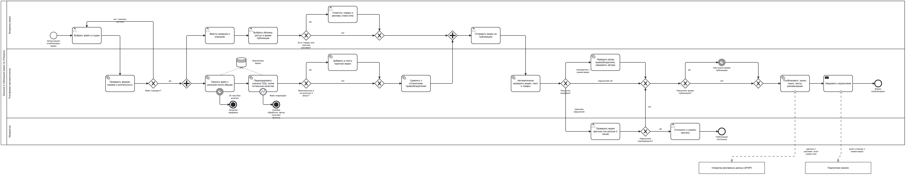
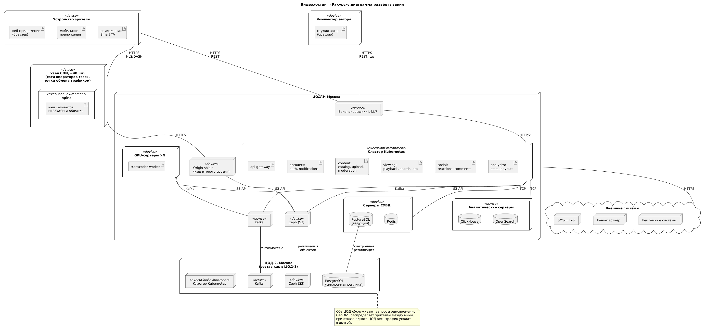

# Архитектура видеохостинга «Ракурс»

Домашнее задание, вариант 1 (учебный кейс). Раздел 1 задаёт исходные данные и допущения. Остальные разделы опираются на эти цифры.

1. [Описание видеохостинга и исходные данные](#1-описание-видеохостинга-и-исходные-данные)
2. [Пользовательские истории владельца видео (задача 1)](#2-пользовательские-истории-владельца-видео-задача-1)
3. [Пользовательские истории зрителя (задача 2)](#3-пользовательские-истории-зрителя-задача-2)
4. [Нефункциональные требования (задача 3)](#4-нефункциональные-требования-задача-3)
5. [Бизнес-процесс загрузки видео (задача 4)](#5-бизнес-процесс-загрузки-видео-задача-4)
6. [Бизнес-слой и слой данных](#6-бизнес-слой-и-слой-данных)
7. [Диаграмма компонентов (задача 5)](#7-диаграмма-компонентов-задача-5)
8. [Диаграмма развёртывания (задача 6)](#8-диаграмма-развёртывания-задача-6)
9. [Источники](#9-источники)

Исходники диаграмм лежат в папке [diagrams](diagrams): `upload-process.bpmn` открывается в [bpmn.io](https://demo.bpmn.io) или Camunda Modeler, файлы `.puml` — в PlantUML. Рядом лежат готовые PNG и SVG.

**В целом не очень, слабая проработка проекта. Слабые таблицы с расчетами показателей, экономики, в целом слабовато. Так же проблема, может взять реальный сервис, чтоб реалистичнее выглядело. Потом пишешь не красиво, используй правила из статьи на Википедии, как понять что текст написан ИИ, английская статья. Пользовательские истории прописаны не очень, мне не нравится, мало понятно, может можно их схемами как-то нарисовать или инфографики, какие-нибудь. В разделе 6.1. нельзя ссылаться в таблице на номера пользовательских историй, это не удобно и не понятно, нужно листать, каждую искать отдельно по коду, не удобно. Нужны масштабные доработки.

---

## 1. Описание видеохостинга и исходные данные

### 1.1. Продукт

«Ракурс» — видеохостинг пользовательских роликов для аудитории в России. Авторы загружают видео на свои каналы, зрители смотрят их бесплатно, а платформа зарабатывает на рекламе в плеере и делится выручкой с авторами. Клиенты: веб, iOS, Android, Smart TV. Прямые трансляции и вертикальные короткие видео в первую версию не входят (надо включить?).

Стратегические цели из условия:

- занять 20% видеотрафика в Российской Федерации;
- получать 86 млн ₽ прибыли в год.

Если такие цели, то надо точно короткие видео подрубать. Пример китайские сервисы коротких видео, где они все продают, в завязке с маркетплейсами. Может тик ток.

### 1.2. Участники

| Роль | Кто это | Что делает на платформе |
|---|---|---|
| Зритель-гость | любой посетитель | ищет и смотрит видео без регистрации |
| Зарегистрированный зритель | пользователь с аккаунтом | дополнительно ставит лайки, пишет комментарии, продолжает просмотр на другом устройстве |
| Владелец видео (автор) | пользователь, создавший канал | загружает и редактирует видео, смотрит статистику, получает выплаты |
| Модератор | сотрудник платформы | проверяет видео, которые автоматика отметила как подозрительные |
| Рекламодатель | компания, покупающая показы | работает через внешние рекламные системы, интерфейсом «Ракурса» не пользуется |
| Администратор | сотрудник эксплуатации | следит за работой системы, управляет настройками |

### 1.3. Правила монетизации

- Реклама показывается перед видео (одному зрителю не чаще раза в 10 минут) и внутри роликов длиннее 10 минут, через каждые 10 минут. В среднем выходит одно рекламное место на 10 минут просмотра (не много ли рекламы, только сосредаточишься на просмотре и реклама, зрители уходить будут).
- Монетизацию можно подключить каналу, у которого не меньше 500 подписчиков и 1000 часов просмотров за последние 90 дней. Получать выплаты может самозанятый, ИП или юридическое лицо.
- Автор получает 50% рекламной выручки со своих видео.
- Начисления за месяц выплачиваются до 15-го числа следующего месяца, если сумма не меньше 1000 ₽. Меньшая сумма переносится на следующий месяц.
- Просмотр засчитывается, если зритель посмотрел не меньше 30 секунд или весь ролик, если он короче. По этому правилу считаются статистика и выплаты. (Слабая статистика)

### 1.4. Масштаб: что значит «20% видеотрафика»

Под видеотрафиком понимаем трафик видеохостингов (VK Видео, YouTube, Rutube и других). Онлайн-кинотеатры и телевидение не учитываем. Если средний битрейт у платформ примерно одинаковый, доля трафика равна доле времени просмотра, поэтому цель удобно пересчитать в часы.

| Показатель | Значение | Как получено |
|---|---|---|
| Ежедневная аудитория VK Видео, YouTube и Rutube | 79 млн | 41,1 + 28,9 + 9 млн, Mediascope, март 2025 [1] |
| Время просмотра на одного посетителя | 1 час в сутки | допущение |
| Время просмотра на всём рынке | ≈ 80 млн часов в сутки | 79 млн × 1 ч с округлением |
| Цель «Ракурса» (20%) | 16 млн часов в сутки | |
| Ежедневная аудитория (DAU) | 16 млн | при том же часе на зрителя |
| Месячная аудитория (MAU) | ≈ 35 млн | допущение: DAU / MAU ≈ 0,45 |
| Просмотров в сутки | ≈ 120 млн | допущение: средний просмотр длится 8 минут |
| Средний битрейт отдачи | 2 Мбит/с, то есть 0,9 ГБ за час | смесь 480p на телефонах и 1080p на компьютерах и ТВ |
| Объём отдачи | 14,4 ПБ в сутки, ≈ 5,3 ЭБ в год | 16 млн ч × 0,9 ГБ |
| Средняя скорость отдачи | 1,33 Тбит/с | 16 млн ч / 24 ч × 2 Мбит/с |
| Пиковая скорость отдачи | 3,3 Тбит/с, ≈ 1,7 млн одновременных просмотров | вечерний пик в 2,5 раза выше среднего |
| Запусков видео в пиковую секунду | ≈ 3,5 тыс. | 120 млн / 86 400 с × 2,5 |
| Загрузки | 100 тыс. роликов в сутки по 10 минут в среднем, ≈ 16,7 тыс. часов видео | допущение |
| Прирост хранилища | ≈ 135 ТБ в сутки, ≈ 50 ПБ в год | оригиналы при 10 Мбит/с (75 ТБ) и версии для отдачи, суммарно 8 Мбит/с на все качества (60 ТБ) |

### 1.5. Экономика: откуда берутся 86 млн ₽

| Показатель | Значение | Как получено |
|---|---|---|
| Рекламных мест | 96 млн в сутки | одно место на 10 минут просмотра |
| Показов рекламы | 67 млн в сутки | допущение: продаётся 70% мест |
| Цена тысячи показов (CPM) | 250 ₽ | средний CPM в VK Видео — 150–500 ₽ [2] |
| Выручка | 16,8 млн ₽ в сутки, 6,13 млрд ₽ в год | ≈ 1,05 ₽ на час просмотра |

Для проверки: 6,13 млрд ₽ — около 0,6% всего рекламного рынка России за 2025 год, который АКАР оценила в 981,6 млрд ₽ [3]. Для площадки с пятой частью видеотрафика такая доля выглядит достижимой.

| Статья за год | млн ₽ | Комментарий |
|---|---:|---|
| Выручка от рекламы | 6 132 | |
| Выплаты авторам | −1 840 | 50% выручки монетизированных каналов, на которые приходится 60% просмотров |
| Персонал, модерация, продажи рекламы, офис | −1 900 | около 500 сотрудников |
| Хранение, обработка видео и вычисления в ЦОД | −800 | |
| Доставка видео зрителям | −1 506 | то, что остаётся после остальных статей и целевой прибыли |
| **Прибыль** | **86** | цель из условия |

Прибыль составляет 1,4% выручки. Если любая крупная статья окажется на несколько процентов выше плана, прибыль исчезнет. Сильнее всего на результат влияют две величины: время просмотра (от него зависят и доля трафика, и выручка) и стоимость доставки часа видео. На них построены требования в разделе 4.

---

## 2. Пользовательские истории владельца видео (задача 1)

Истории записаны в форме «Как <роль>, я хочу <действие>, чтобы <ценность>». Основной сценарий каждой истории описан в форме «Дано / когда / тогда», остальные критерии — правила, которые тоже должны выполняться. История принята, когда выполнены все её критерии.

### ВВ-1. Регистрация

> Как автор, я хочу зарегистрироваться и создать канал, чтобы загружать на него видео.

Критерии приёмки:

1. **Дано**: пользователь не зарегистрирован. **Когда** он вводит номер телефона и верный код из SMS, **тогда** он задаёт пароль и переходит к созданию канала.
2. Код из SMS действует 5 минут. После трёх неверных попыток новый код можно запросить через 60 секунд.
3. Пароль — не короче 8 символов, содержит хотя бы одну букву и одну цифру. Если пароль не подходит, у поля появляется подсказка и форма не отправляется.
4. Если номер уже зарегистрирован, система предлагает войти или восстановить пароль. Второй аккаунт на тот же номер не создаётся.
5. Для канала задаются название (от 1 до 50 символов) и адрес вида @name (от 3 до 30 символов: латиница, цифры, «_»). Занятость адреса проверяется во время ввода.
6. Регистрацию нельзя завершить, не приняв пользовательское соглашение и правила для авторов.
7. Пользователь, у которого уже есть аккаунт зрителя, повторно не регистрируется: он создаёт канал из своего профиля.

### ВВ-2. Вход в личный кабинет

> Как автор, я хочу входить в студию по телефону или почте и паролю, чтобы управлять своими видео с любого устройства.

1. **Дано**: автор зарегистрирован. **Когда** он вводит верные телефон (или почту) и пароль, **тогда** открывается студия со списком его видео.
2. При неверном логине или пароле показывается одно сообщение «Неверный логин или пароль» без уточнения, что именно введено неправильно.
3. После 5 неудачных попыток подряд вход в аккаунт блокируется на 15 минут, а автору приходит SMS об этом.
4. Если у канала подключена монетизация, при входе с нового устройства нужно ввести ещё и код из SMS.
5. С отметкой «Запомнить меня» сессия живёт 30 дней, без неё заканчивается после 24 часов бездействия.
6. По ссылке «Забыли пароль?» автор задаёт новый пароль после подтверждения кодом из SMS.

### ВВ-3. Выход из личного кабинета

> Как автор, я хочу выходить из студии, чтобы никто не смог управлять моим каналом с общего компьютера.

1. **Дано**: автор находится в студии. **Когда** он нажимает «Выйти», **тогда** сессия на этом устройстве завершается и открывается главная страница.
2. После выхода кнопка «Назад» в браузере и сохранённые ссылки на студию ведут на форму входа.
3. Если в этот момент идёт загрузка видео, система предупреждает, что загрузка прервётся, и выходит только после подтверждения.
4. В настройках есть список активных сеансов и кнопка «Выйти на всех устройствах». После неё все сессии, кроме текущей, перестают действовать не позже чем через минуту.

### ВВ-4. Загрузка видео

> Как автор, я хочу загрузить видеофайл со своего компьютера, чтобы опубликовать его на канале.

1. **Дано**: автор находится в студии. **Когда** он перетаскивает файл в окно или выбирает его в диалоге, **тогда** загрузка начинается сразу, а на экране видны шкала прогресса и оставшееся время.
2. Принимаются файлы MP4, MOV, MKV, WebM и AVI размером до 50 ГБ и длительностью до 12 часов. Неподходящий файл отклоняется до начала передачи, причина показывается автору.
3. При обрыве связи загрузка продолжается с места остановки. Продолжить её можно в течение 24 часов, в том числе после перезапуска браузера, если снова выбрать тот же файл.
4. Одновременно можно загружать до 10 файлов, у каждого своя карточка со статусом.
5. Пока файл загружается и обрабатывается, автор может заполнять название, описание и настройки (ВВ-5, ВВ-7) — ждать окончания обработки не нужно.
6. Видео проходит статусы «Загружается» → «Обрабатывается» → «Готово к публикации» → «На проверке» → «Опубликовано» или «Отклонено». О каждой смене статуса автору приходит уведомление в студии и push-уведомление.
7. До публикации видео видит только автор.
8. Если файл повреждён и не обрабатывается, видео получает статус «Ошибка обработки», а автору предлагается загрузить файл заново.

### ВВ-5. Название и описание видео

> Как автор, я хочу добавить к видео название и описание, чтобы зрители находили его в поиске и понимали, о чём ролик.

1. **Дано**: видео загружается или уже загружено. **Когда** автор открывает его карточку, **тогда** поле названия уже заполнено именем файла без расширения, и его можно заменить.
2. Название обязательно, от 1 до 100 символов. Без названия кнопка «Опубликовать» неактивна.
3. Описание необязательно, до 5000 символов. Ссылки в описании становятся кликабельными, хэштеги (#слово) — ссылками на поиск.
4. Под полями виден счётчик символов, ввести больше лимита нельзя.
5. Черновик сохраняется автоматически не реже раза в 10 секунд. Если закрыть вкладку, введённый текст не потеряется.
6. Название и описание проходят автоматическую проверку вместе с видео (процесс в разделе 5).
7. После публикации видео ищется по словам из названия и описания не позже чем через 5 минут.

### ВВ-6. Удаление видео

> Как автор, я хочу удалить своё видео, чтобы оно больше не было доступно зрителям.

1. **Дано**: автор в списке своих видео. **Когда** он выбирает «Удалить» и подтверждает действие, **тогда** видео пропадает с канала и из поиска не позже чем через 5 минут.
2. В окне подтверждения сказано, что лайки и комментарии будут скрыты вместе с видео, а через 30 дней удалены без возможности восстановления.
3. По прямой ссылке на удалённое видео открывается страница «Видео удалено автором».
4. 30 дней видео лежит в разделе «Удалённые», откуда его можно восстановить вместе с лайками и комментариями. После этого файлы и данные видео удаляются безвозвратно.
5. Статистика и начисления за время, пока видео было опубликовано, остаются в отчётах автора.
6. Можно выбрать несколько видео и удалить их одним действием.
7. Удалить видео может только владелец канала.

### ВВ-7. Редактирование видео

Под редактированием понимаем изменение уже загруженного ролика без повторной загрузки: обложки, доступа, возрастного ограничения и обрезку начала или конца. Изменение названия и описания описано в ВВ-5.

> Как автор, я хочу менять параметры и содержимое загруженного видео, чтобы исправлять ошибки без повторной загрузки и не терять набранные просмотры.

1. **Дано**: видео опубликовано. **Когда** автор меняет обложку, доступ (открытое, по ссылке, приватное) или ставит ограничение 18+ и нажимает «Сохранить», **тогда** зрители видят изменения не позже чем через 5 минут.
2. Обложку можно выбрать из трёх кадров, которые предлагает система, или загрузить свою: JPG или PNG до 2 МБ с соотношением сторон 16:9.
3. Для обрезки автор отмечает на шкале новое начало и конец. Пока новая версия обрабатывается, зрителям показывается старая.
4. После редактирования сохраняются просмотры, лайки, комментарии и ссылка на видео.
5. Новая обложка и обрезанная версия проходят автоматическую проверку, до её окончания зрители видят прежний вариант.
6. До сохранения все изменения можно отменить кнопкой «Отменить».

### ВВ-8. Статистика по видео: просмотры, лайки, выплаты

> Как автор, я хочу видеть просмотры, лайки и выплаты по каждому видео, чтобы понимать, какие ролики приносят аудиторию и доход.

1. **Дано**: автор в разделе «Статистика». **Когда** он выбирает видео и период (7, 28, 90 дней, год или свои даты), **тогда** видит число просмотров, время просмотра, лайки и начисленный доход за период и график по дням.
2. Просмотры считаются по правилу из раздела 1.3. Повторные просмотры одного видео одним зрителем чаще раза в 30 минут не учитываются.
3. Просмотры и лайки обновляются с задержкой не больше часа, доход — раз в сутки, после сверки с рекламными системами.
4. На вкладке «Выплаты» показаны начисления по месяцам, статус («Начислено», «Ожидает выплаты», «Выплачено», «Перенесено: меньше 1000 ₽») и дата перечисления.
5. Таблицы можно выгрузить в CSV.
6. Если монетизация не подключена, вместо дохода показываются условия подключения.
7. Статистику канала видит только его владелец.

---

## 3. Пользовательские истории зрителя (задача 2)

### З-1. Поиск видео

> Как зритель, я хочу найти видео по словам из названия, описания или по имени канала, чтобы быстро посмотреть то, что мне нужно.

1. **Дано**: зритель на любой странице. **Когда** он вводит запрос в строку поиска и нажимает Enter, **тогда** не позже чем через секунду видит список подходящих опубликованных видео.
2. После второго введённого символа под строкой появляются до 10 подсказок.
3. Поиск находит видео, если в запросе ошибка в одном-двух символах или он набран в неверной раскладке («ghbdtn» находит «привет»).
4. В выдаче у каждого видео есть обложка, название, канал, число просмотров, дата публикации и длительность.
5. Есть фильтры по дате загрузки и длительности (до 4 минут, 4–20 минут, больше 20 минут) и сортировка по релевантности, дате и просмотрам.
6. Приватные, удалённые и неопубликованные видео в выдачу не попадают. Видео 18+ показываются только авторизованным зрителям старше 18 лет.
7. Если ничего не найдено, зритель видит сообщение об этом и предложение изменить запрос.
8. Поиск работает без регистрации.

### З-2. Просмотр видео

> Как зритель, я хочу смотреть видео без долгой загрузки и остановок, чтобы не отвлекаться от содержания.

1. **Дано**: зритель на странице видео, скорость соединения не ниже 5 Мбит/с. **Когда** он нажимает «Воспроизвести», **тогда** видео (или реклама перед ним) начинается не позже чем через 2 секунды (НФТ-2).
2. Качество подбирается автоматически по скорости соединения и размеру экрана. Зритель может выбрать его вручную, от 240p до 1080p.
3. В плеере есть пауза, перемотка, громкость, скорость от 0,5× до 2×, полноэкранный режим и субтитры, если автор их добавил.
4. Рекламу перед видео можно пропустить через 5 секунд, её длительность — не больше 30 секунд.
5. У авторизованного зрителя запоминается место, где он остановился, и при следующем открытии видео продолжается с него, в том числе на другом устройстве.
6. Смотреть видео можно без регистрации. Видео 18+ доступны только после входа и подтверждения возраста.
7. Видео с доступом «по ссылке» открывается по прямой ссылке, но не показывается в поиске и на канале.
8. Если видео удалено или скрыто, вместо плеера показывается причина.

### З-3. Регистрация зрителя

> Как зритель, я хочу зарегистрироваться, чтобы ставить лайки, писать комментарии и продолжать просмотр на других устройствах.

1. **Дано**: зритель не зарегистрирован. **Когда** он нажимает «Войти» → «Создать аккаунт» и подтверждает номер телефона кодом из SMS, **тогда** аккаунт создан и зритель сразу авторизован.
2. Обязательные поля — телефон, пароль, имя для комментариев и дата рождения. Почту указывать необязательно.
3. Код из SMS и пароль проверяются по тем же правилам, что в ВВ-1.
4. Если регистрация начата со страницы видео, после неё зритель возвращается на ту же страницу и к той же секунде.
5. Дата рождения нужна для доступа к видео 18+. Изменить её после регистрации можно только через поддержку.
6. Зарегистрированный зритель в любой момент может создать канал и стать автором (ВВ-1, п. 7).

### З-4. Вход на странице просмотра и выход

Понимаем как вход в аккаунт и выход из него, не уходя со страницы просмотра.

> Как зритель, я хочу войти в аккаунт прямо со страницы видео и выйти из него, чтобы не прерывать просмотр и не оставлять аккаунт открытым на чужом устройстве.

1. **Дано**: зритель смотрит видео без авторизации. **Когда** он нажимает «Войти», **тогда** форма входа открывается поверх страницы, а видео ставится на паузу.
2. После успешного входа форма закрывается, воспроизведение продолжается с той же секунды, в шапке появляются аватар и имя.
3. Ошибки и блокировка после 5 неудачных попыток работают так же, как в ВВ-2.
4. Если вход начат с кнопки «Нравится» или с поля комментария, после входа действие выполняется: лайк ставится, а набранный текст комментария сохраняется.
5. **Дано**: зритель авторизован. **Когда** он выбирает «Выйти» в меню аккаунта, **тогда** сессия завершается, страница остаётся открытой и видео продолжает играть, а кнопка лайка и поле комментария предлагают войти.
6. Если на странице видео 18+, после выхода оно останавливается и показывает запрос входа.

### З-5. Лайк и отзыв лайка

> Как зритель, я хочу отметить понравившееся видео лайком и снять отметку, если передумал, чтобы поддержать автора и сохранить видео в списке «Понравившиеся».

1. **Дано**: авторизованный зритель на странице видео. **Когда** он нажимает «Нравится», **тогда** кнопка становится активной, счётчик сразу увеличивается на 1, а видео попадает в список «Понравившиеся».
2. **Когда** зритель нажимает активную кнопку ещё раз, **тогда** лайк снимается, счётчик уменьшается на 1, видео пропадает из списка.
3. Один зритель может поставить одному видео не больше одного лайка. Быстрые повторные нажатия не создают дубликатов.
4. Неавторизованному зрителю при нажатии предлагается войти, после входа лайк ставится автоматически (З-4, п. 4).
5. Другие зрители видят обновлённый счётчик не позже чем через минуту, автор — в статистике по правилам ВВ-8.
6. Если запрос не дошёл до сервера, кнопка возвращается в прежнее состояние и показывается сообщение об ошибке.

### З-6. Комментарий к видео

> Как зритель, я хочу оставить комментарий к видео, чтобы высказать мнение или задать вопрос автору.

1. **Дано**: зритель авторизован, комментарии к видео включены. **Когда** он вводит текст и нажимает «Отправить», **тогда** комментарий сразу появляется у него первым в списке с отметкой времени.
2. Длина комментария — от 1 до 2000 символов. Пустой комментарий или комментарий из одних пробелов отправить нельзя.
3. Другие зрители видят комментарий после автоматической проверки на спам и запрещённые слова, не позже чем через 10 секунд. Комментарий, не прошедший проверку, видит только его автор, с пометкой «Скрыт».
4. На чужой комментарий можно ответить, ответы показываются под ним.
5. Один зритель может отправить не больше 10 комментариев в минуту. При превышении он видит сообщение «Слишком часто, попробуйте через минуту».
6. Если владелец видео отключил комментарии, поля ввода нет, вместо него написано «Комментарии отключены».
7. Неавторизованному зрителю поле комментария предлагает войти.

### З-7. Удаление комментария

> Как зритель, я хочу удалить свой комментарий, чтобы убрать то, что написал по ошибке.

1. **Дано**: авторизованный зритель видит свой комментарий. **Когда** он выбирает «Удалить» в меню комментария и подтверждает действие, **тогда** комментарий пропадает у всех зрителей не позже чем через минуту.
2. Пункт «Удалить» есть только у собственных комментариев зрителя.
3. Если на комментарий уже ответили, вместо текста остаётся строка «Комментарий удалён», а ответы сохраняются. Если ответов нет, комментарий удаляется целиком.
4. Счётчик комментариев под видео уменьшается.
5. Восстановить удалённый комментарий нельзя, об этом сказано в окне подтверждения.
6. Владелец видео может удалить любой комментарий под своим видео — со страницы видео или из студии.

---

## 4. Нефункциональные требования (задача 3)

Обе стратегические цели сводятся к двум величинам из раздела 1: времени просмотра (доля трафика и выручка) и стоимости часа просмотра (прибыль). Каждое требование ниже защищает одну из них. Для каждого указано, как его проверять, почему оно именно такое и что из него следует для архитектуры.

| № | Атрибут качества | Требование коротко |
|---|---|---|
| НФТ-1 | Производительность и масштабируемость | выдерживать пиковую нагрузку 3,3 Тбит/с с запасом 50%, расти вдвое добавлением серверов |
| НФТ-2 | Качество воспроизведения | старт видео не дольше 2 с для 90% запусков, буферизация не больше 0,5% времени просмотра |
| НФТ-3 | Доступность | просмотр и поиск — 99,95%, загрузка и студия — 99,9% |
| НФТ-4 | Экономическая эффективность | доставка 1 ГБ видео не дороже 0,29 ₽ |
| НФТ-5 | Время обработки | ролик до 10 минут готов к публикации через 5 минут после загрузки |
| НФТ-6 | Безопасность и соответствие закону | персональные данные хранятся в России, реквизиты для выплат зашифрованы |

### НФТ-1. Производительность и масштабируемость

**Требование.** Система выдерживает пиковую нагрузку из раздела 1.4 с запасом 50%: отдаёт видео на скорости 5 Тбит/с и обслуживает 2,5 млн одновременных просмотров, 5,3 тыс. запусков видео и 84 тыс. событий статистики в секунду. Чтобы выдержать вдвое большую нагрузку, достаточно добавить серверы и узлы CDN — архитектуру менять не нужно.

**Как проверяем.** Нагрузочные тесты API и сценария запуска видео перед крупными релизами. В мониторинге — загрузка каналов CDN: в пиковый час в среднем не выше 70%.

**Обоснование.**

- Цифры получены прямо из цели «20% видеотрафика»: 16 млн часов просмотра в сутки, вечерний пик в 2,5 раза выше среднего, 2 Мбит/с на поток (раздел 1.4).
- События статистики: плеер раз в 30 секунд отправляет отметку о просмотре, 1,7 млн потоков / 30 с ≈ 56 тыс. в секунду в пик.
- Запас 50% нужен по трём причинам: нагрузка неравномерна по регионам, при отказе узла CDN его зрителей забирают соседние узлы, а выход популярных роликов даёт всплески.
- Требование к росту следует из того, что цель — это доля рынка. Пока «Ракурс» к ней идёт, нагрузка растёт, и переделывать систему на каждом шаге слишком дорого.

**Что следует для архитектуры.** Видео отдаёт только CDN, прикладные сервисы в отдаче сегментов не участвуют. Сервисы не хранят состояние и масштабируются добавлением экземпляров в Kubernetes. События статистики идут через Kafka, а не синхронными вызовами.

### НФТ-2. Качество воспроизведения

**Требование.** При скорости соединения от 5 Мбит/с первый кадр видео или рекламы появляется не позже чем через 2 секунды после нажатия «Воспроизвести» в 90% запусков и не позже чем через 1 секунду в медиане. Буферизация занимает не больше 0,5% времени просмотра. Показатели считаются отдельно по каждому федеральному округу и типу устройства.

**Как проверяем.** Плеер отправляет в сервис статистики время старта и длительность каждой остановки на буферизацию. На дашборде показатели разбиты по регионам и операторам связи. Если порог превышен в каком-либо регионе дольше 15 минут, заводится инцидент.

**Обоснование.**

- Krishnan и Sitaraman изучили 23 млн просмотров [5]. Зрители начинают уходить, если видео не запустилось за 2 секунды, и каждая следующая секунда ожидания увеличивает долю ушедших примерно на 5,8%. Буферизация длиной в 1% ролика сокращает время его просмотра на 5%.
- Пример для «Ракурса»: если 10% запусков будут занимать 4 секунды вместо 2, примерно 11,6% из них прервутся, то есть платформа потеряет ≈ 1,2% просмотров. Это ≈ 71 млн ₽ выручки в год, почти вся плановая прибыль (86 млн ₽), и такое же снижение доли трафика.
- 5 Мбит/с — обычная скорость мобильного 4G и домашнего интернета. На медленных соединениях требование выполняется за счёт более низкого качества.

**Что следует для архитектуры.** Узлы CDN стоят внутри сетей операторов, близко к зрителю. Видео отдаётся с адаптивным битрейтом (HLS/DASH) короткими сегментами по 2–4 секунды, первый сегмент — в невысоком качестве. Сервис воспроизведения выдаёт манифест и ссылку на ближайший узел одним запросом.

### НФТ-3. Доступность

**Требование.**

- Просмотр, поиск и страницы видео: доступность 99,95% за месяц, то есть не больше 22 минут простоя в месяц (около 4,4 часа в год).
- Загрузка, студия автора, лайки и комментарии: 99,9% за месяц, не больше 43 минут простоя в месяц.
- Отказ одного ЦОД не останавливает просмотр, переключение занимает не больше 5 минут (RTO). Данные о загрузках, начислениях и выплатах при этом не теряются (RPO = 0), данные статистики — не больше чем за 5 минут.

**Как проверяем.** Доступность — доля успешных запросов (без ошибок 5xx и таймаутов) по синтетическим проверкам из всех федеральных округов и по логам CDN. Раз в квартал проводятся учения с отключением одного ЦОД.

**Обоснование.**

- Цена часа простоя. Час просмотра приносит 1,05 ₽ выручки, из которых ≈ 0,31 ₽ уходит на выплаты авторам и ≈ 0,26 ₽ на доставку (раздел 1.5), остаётся ≈ 0,48 ₽. В среднем каждый час на платформе смотрят 0,67 млн часов видео, значит полный простой стоит ≈ 0,32 млн ₽ в час, а в вечерний пик — ≈ 0,8 млн ₽.

  | Доступность | Простой в год | Потери (оценка сверху) | Доля годовой прибыли |
  |---|---|---|---|
  | 99,0% | 87,6 ч | ≈ 28 млн ₽ | 32% |
  | 99,9% | 8,8 ч | ≈ 2,8 млн ₽ | 3,2% |
  | 99,95% | 4,4 ч | ≈ 1,4 млн ₽ | 1,6% |

- Прямые потери — не главное. Зритель, у которого видео не открылось, уходит в VK Видео или Rutube, и часть таких зрителей не возвращается. Для цели «20% трафика» это опаснее упущенной выручки.
- 99,99% потребовали бы третьего ЦОД, а потери уменьшились бы всего на ≈ 1,1 млн ₽ в год. Это намного меньше стоимости ещё одной площадки, поэтому выбран уровень 99,95%.
- Для загрузки и студии планка ниже: автор может подождать, загрузка продолжается с места обрыва (ВВ-4), время просмотра от этого не теряется. Опустить её ниже 99,9% нельзя: если студия недоступна в момент запланированной публикации, автор теряет просмотры первых часов.
- RPO = 0 для начислений: потерянная запись означает недоплату автору и спор с ним. Потеря нескольких минут статистики на отчёты и выплаты почти не влияет.

**Что следует для архитектуры.** Два ЦОД в Москве работают одновременно (active-active), между ними синхронная репликация PostgreSQL, каждый видеофайл хранится в обоих ЦОД. Популярные видео CDN продолжает отдавать из кэша, даже если оба ЦОД недоступны.

### НФТ-4. Стоимость доставки трафика

**Требование.** Полная стоимость доставки зрителю 1 ГБ видео — каналы связи, узлы CDN, их размещение и обслуживание — не больше 0,29 ₽, то есть не больше 0,26 ₽ на час просмотра. Не меньше 95% запросов сегментов обслуживает кэш узла CDN, не обращаясь к хранилищу в ЦОД.

**Как проверяем.** Раз в месяц расходы на доставку делятся на объём отданного трафика. Доля попаданий в кэш считается по логам CDN.

**Обоснование.**

- Прибыль — 1,4% выручки, а доставка — одна из трёх крупнейших статей расходов (раздел 1.5). На неё остаётся 1,5 млрд ₽ в год при 5,3 ЭБ трафика: 0,29 ₽ за ГБ.
- Для сравнения, публичный облачный CDN стоит 1,054 ₽ за ГБ с НДС, ≈ 0,86 ₽ без НДС [4]. По такой цене доставка обойдётся в ≈ 4,5 млрд ₽ в год, втрое дороже бюджета, и вместо 86 млн ₽ прибыли получится ≈ 2,9 млрд ₽ убытка. Значит, цель по прибыли недостижима без собственной сети доставки, которая минимум втрое дешевле облачного тарифа.
- Каждый промах кэша — это трафик между ЦОД и узлом, который оплачивается дважды. Просмотры сосредоточены на популярных роликах, поэтому 95% попаданий достижимы при кэше узла в десятки терабайт.

**Что следует для архитектуры.** Собственная CDN: узлы стоят у крупных операторов связи и в точках обмена трафиком (операторам это выгодно, трафик не уходит из их сети). В ЦОД — кэш второго уровня (origin shield). Популярные ролики дополнительно кодируются в AV1, который при том же качестве требует примерно на 30% меньший битрейт. Плеер не запрашивает качество выше разрешения экрана.

### НФТ-5. Время обработки загруженного видео

**Требование.** Ролик длительностью до 10 минут готов к публикации не позже чем через 5 минут после окончания загрузки в 95% случаев, более длинный — не позже чем через половину своей длительности. Ручная модерация в это время не входит, на неё отводится до 2 часов. Система обрабатывает в среднем 700, а в пик — 2100 часов исходного видео за час.

**Как проверяем.** Для каждого ролика сохраняются время окончания загрузки и время перехода в статус «Готово к публикации». 95-й перцентиль за сутки выводится на дашборд.

**Обоснование.**

- Авторы приносят контент, а контент — время просмотра. Автор выбирает площадку, где ролик быстро становится доступен. Если обработка затягивается, он публикуется сначала у конкурента.
- Обычно больше всего просмотров ролик набирает в первые часы после публикации, когда подписчики получают уведомление. Видео, застрявшее в обработке, теряет этот всплеск.
- Нагрузка: 16,7 тыс. часов исходного видео в сутки (раздел 1.4), в среднем ≈ 700 часов в час. Загрузки распределены неравномерно, поэтому взят пиковый коэффициент 3.

**Что следует для архитектуры.** Ролик режется на фрагменты по несколько секунд, и они кодируются параллельно на GPU-серверах. Сначала готовится одно качество (720p), его достаточно для публикации, остальные досчитываются потом. Задания на обработку идут через очередь в Kafka. Автор оформляет видео параллельно с обработкой (процесс в разделе 5).

### НФТ-6. Защита данных и соответствие закону

**Требование.**

- Персональные данные пользователей (телефон, почта, дата рождения, реквизиты для выплат) хранятся и обрабатываются только в ЦОД на территории России.
- Пароли хранятся только в виде хешей (Argon2), реквизиты для выплат — в зашифрованном виде, расшифровать их может только сервис выплат.
- Весь трафик между клиентами и платформой идёт по TLS 1.2 и выше.
- Вход в канал с монетизацией с нового устройства и изменение реквизитов подтверждаются кодом из SMS.
- Все действия сотрудников с персональными данными и реквизитами записываются в журнал, журнал хранится не меньше года.

**Как проверяем.** Ежегодный внешний аудит и тест на проникновение, автоматическая проверка конфигураций при выкладке.

**Обоснование.**

- Закон о персональных данных (152-ФЗ, ч. 5 ст. 18) требует хранить и обрабатывать персональные данные граждан России в базах данных на её территории [6].
- Из-за выплат аккаунты авторов становятся ценной целью: взломав канал, злоумышленник меняет реквизиты и забирает чужие деньги. Платформа теряет и деньги, и доверие авторов, а без авторов не будет контента.

**Что следует для архитектуры.** ЦОД только в России. Сервис выплат выделен отдельно со своей изолированной базой данных. Для персональных данных не используются зарубежные облака.

---

## 5. Бизнес-процесс загрузки видео (задача 4)

Исходник: [diagrams/upload-process.bpmn](diagrams/upload-process.bpmn) (BPMN 2.0).

В процессе три участника: владелец видео, платформа (автоматические шаги) и модератор.

1. Автор выбирает файл в студии. Платформа сразу проверяет формат, размер и длительность и, если файл не подходит, возвращает его автору с причиной. Проверка идёт до передачи файла, чтобы автор не потратил час на загрузку 50 ГБ, которые потом отклонят.
2. Дальше два потока идут параллельно. Платформа принимает файл (с докачкой при обрыве) и перекодирует его, а автор в это время вводит название и описание, выбирает обложку, доступ и время публикации. Благодаря этому выполняется НФТ-5: автор не ждёт окончания обработки, чтобы оформить видео.
3. Когда оба потока закончены, автор отправляет видео на публикацию.
4. Автоматическая проверка ищет признаки нарушений в видео, названии и описании. Если их нет, видео идёт к публикации. Если есть, решение принимает модератор. Автоматика сама видео не отклоняет: ошибочный отказ бьёт по автору сильнее, чем задержка на ручную проверку.
5. Если автор назначил время публикации, видео ждёт его на таймере. После публикации подписчики получают уведомление.
6. Если модератор подтвердил нарушение, публикация отклоняется, и автор получает причину.

---

## 6. Бизнес-слой и слой данных

### 6.1. Бизнес-слой

| Бизнес-сервис | Для кого | Бизнес-процессы | Истории |
|---|---|---|---|
| Управление аккаунтом | все пользователи | регистрация, вход, выход, восстановление пароля | ВВ-1–3, З-3, З-4 |
| Публикация видео | автор | загрузка и публикация (раздел 5), редактирование, удаление | ВВ-4–7 |
| Просмотр и поиск | зритель | поиск, воспроизведение, показ рекламы | З-1, З-2 |
| Взаимодействие с аудиторией | зритель, автор | лайки, комментарии, уведомления подписчиков | З-5–7 |
| Модерация | модератор | проверка видео, отмеченных автоматикой | раздел 5 |
| Аналитика для авторов | автор | сбор и показ статистики | ВВ-8 |
| Монетизация | автор, рекламодатель | продажа показов, начисления, выплаты | ВВ-8 |

Бизнес-правила (подсчёт просмотров, условия монетизации, доля автора, порог выплаты) приведены в разделе 1.3.

### 6.2. Слой данных

Каждый сервис владеет своими данными, другие сервисы получают их через API или события. Транзакционные данные лежат в PostgreSQL, аналитика — в ClickHouse, видеофайлы — в объектном хранилище, а не в базе данных.

| Сущность | Основные атрибуты | Владелец и хранилище | Объём |
|---|---|---|---|
| Пользователь | телефон, почта, хеш пароля, дата рождения, статус | учётные записи, PostgreSQL | ≈ 35 млн |
| Сессия | токен, устройство, срок действия | учётные записи, Redis | десятки миллионов |
| Канал | владелец, название, адрес @name, статус монетизации | каталог, PostgreSQL | ≈ 2 млн |
| Видео | канал, название, описание, доступ, возрастное ограничение, статус, длительность | каталог, PostgreSQL; копия для поиска в OpenSearch | +100 тыс. в сутки |
| Видеофайлы | оригинал, версии HLS/DASH по качествам, обложки | загрузка и обработка, объектное хранилище S3 (Ceph) | +50 ПБ в год |
| Решение модерации | видео, модератор, вердикт, причина | модерация, PostgreSQL | |
| Лайк | зритель, видео, время | реакции, PostgreSQL, счётчики в Redis | сотни миллионов |
| Комментарий | видео, автор, текст, родительский комментарий, статус | комментарии, PostgreSQL (шардирование по видео) | |
| Событие просмотра | видео, зритель, позиция, качество, время буферизации | статистика, Kafka → ClickHouse | до 56 тыс. в секунду |
| Показ рекламы | кампания, видео, время | реклама, ClickHouse | ≈ 67 млн в сутки |
| Начисление | канал, видео, месяц, сумма | выплаты, PostgreSQL | |
| Выплата | получатель, зашифрованные реквизиты, сумма, статус | выплаты, отдельная PostgreSQL | |

Основные события в Kafka: `video.uploaded`, `video.processed`, `video.moderated`, `video.published`, `video.deleted`, `reaction.changed`, `comment.created`, `playback.heartbeat`, `ad.impression`. Например, `video.published` получают поиск (индексирует видео) и уведомления (сообщают подписчикам).

---

## 7. Диаграмма компонентов (задача 5)

Исходник: [diagrams/components.puml](diagrams/components.puml).

Клиенты обращаются к платформе через два интерфейса: REST API за API-шлюзом и HLS/DASH через CDN. Сервисы сгруппированы по доменам, у каждого внутри показано его хранилище. Шлюз проверяет токен, ограничивает частоту запросов и передаёт их сервисам по gRPC. Сервисы обмениваются событиями через Kafka.

| Компонент | За что отвечает |
|---|---|
| API-шлюз | TLS, проверка токена, ограничение частоты запросов, маршрутизация |
| CDN | кэширование и отдача сегментов видео и обложек |
| Учётные записи | регистрация, вход, сессии, второй фактор |
| Уведомления | push, SMS, письма, уведомления в студии |
| Загрузка | приём файлов с докачкой (протокол tus) |
| Обработка видео | нарезка, перекодирование в HLS/DASH, кадры для обложек |
| Каталог видео и каналов | метаданные, статусы, права доступа, жизненный цикл видео |
| Модерация | автоматическая проверка, очередь и решения модераторов |
| Воспроизведение | проверка доступа, выдача манифеста и подписанных ссылок на CDN |
| Поиск | индекс опубликованных видео, поиск, подсказки |
| Реклама | выбор рекламы, учёт показов, обмен с рекламными системами |
| Реакции | лайки и их счётчики |
| Комментарии | комментарии, ответы, антиспам |
| Статистика | приём событий плеера, отчёты для авторов |
| Монетизация и выплаты | начисления, реквизиты, выплаты через банк |

---

## 8. Диаграмма развёртывания (задача 6)

Исходник: [diagrams/deployment.puml](diagrams/deployment.puml).

- Около 40 узлов CDN стоят в сетях крупных операторов связи и в точках обмена трафиком во всех федеральных округах. Они стоят близко к зрителю (НФТ-2), обслуживают из кэша не меньше 95% запросов (НФТ-4) и обращаются в ЦОД только при промахе, через origin shield.
- Два ЦОД в Москве обслуживают запросы одновременно, зрителей между ними распределяет GeoDNS (НФТ-3). Близость площадок позволяет синхронно реплицировать PostgreSQL почти без задержки.
- Сервисы без состояния развёрнуты в Kubernetes, на диаграмме они сгруппированы по доменам, как на диаграмме компонентов. Транскодирование идёт на отдельных GPU-серверах (НФТ-5), базы данных — на выделенных серверах.
- Между ЦОД реплицируются PostgreSQL (синхронно), объектное хранилище Ceph и Kafka (MirrorMaker 2).
- Внешние системы — SMS-шлюз, банк-партнёр, рекламные системы — подключаются по HTTPS.

---

## 9. Источники

1. [VK Видео и YouTube стали самыми популярными видеохостингами у россиян в марте](https://habr.com/ru/articles/898112/) — Хабр, 7 апреля 2025 (данные Mediascope).
2. [VK Видео уже обогнал YouTube. Что это значит для рекламодателей](https://www.sostav.ru/blogs/291616/92465) — Sostav, 24 июня 2026.
3. [Российский рекламный рынок: итоги за 2025 год](https://ppc.world/news/tempy-rosta-rossiyskogo-reklamnogo-rynka-rezko-snizilis-v-2025-godu-issledovanie-akar/) — ppc.world (оценка АКАР).
4. [Правила тарификации Cloud CDN](https://yandex.cloud/ru/docs/cdn/pricing) — Yandex Cloud, цены с 30 апреля 2026.
5. Krishnan S. S., Sitaraman R. K. Video Stream Quality Impacts Viewer Behavior: Inferring Causality Using Quasi-Experimental Designs. ACM IMC 2012; IEEE/ACM Transactions on Networking, 2013. [Краткое изложение результатов](https://www.sciencedaily.com/releases/2012/11/121113134805.htm).
6. [Федеральный закон от 27.07.2006 № 152-ФЗ «О персональных данных»](https://www.consultant.ru/document/cons_doc_LAW_61801/), ч. 5 ст. 18.
